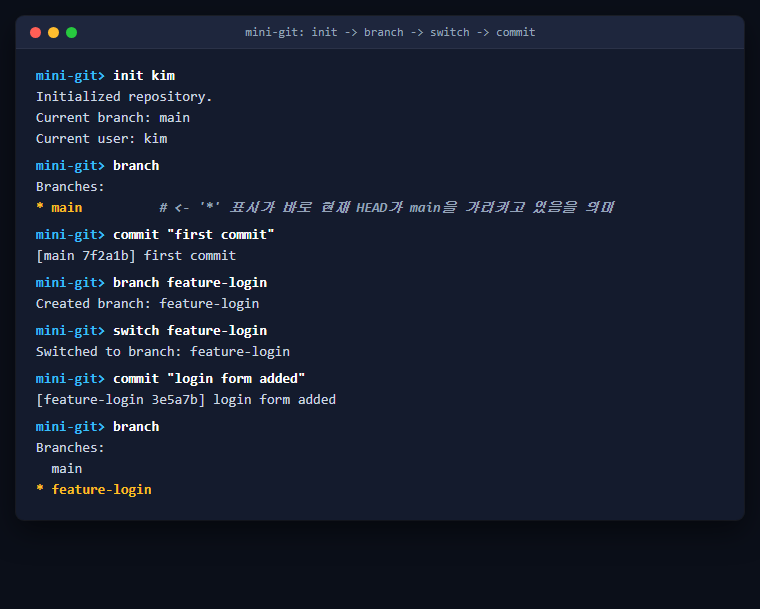
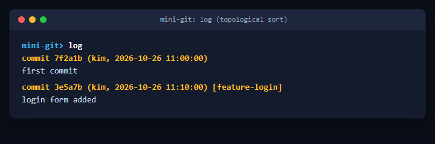
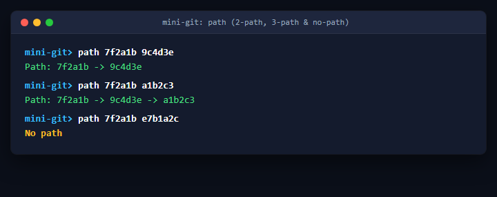
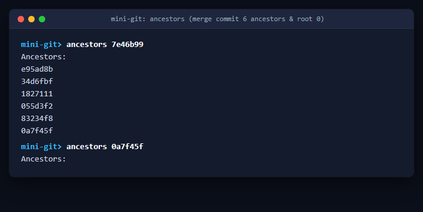
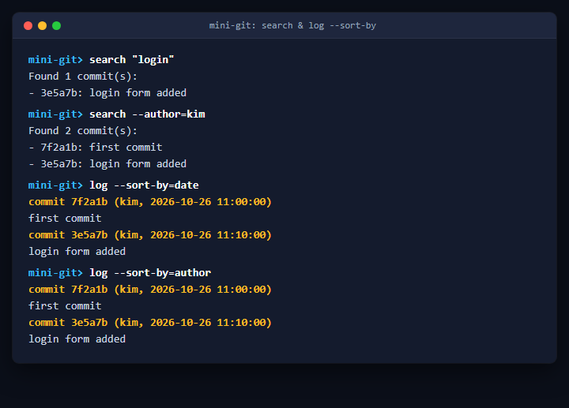
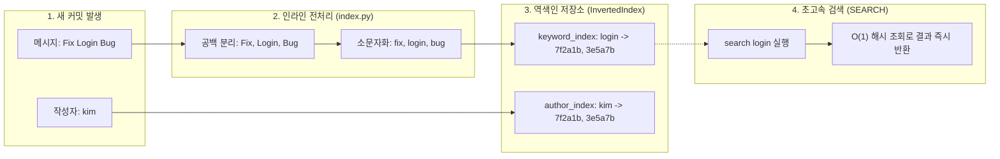
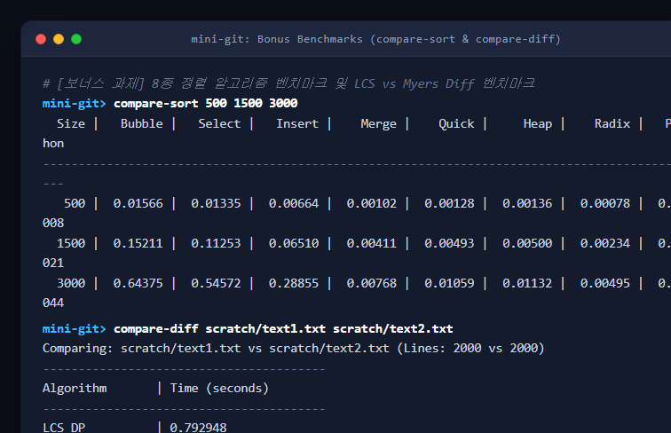

# Mini Git

CLI 기반의 Mini Git 구현 프로젝트이다. 커밋 그래프, 정렬, 최단 경로, 역색인 검색 등의 자료구조와 알고리즘을 활용하여 Git의 핵심 동작을 시뮬레이션한다.

## 실행 방법

```bash

python main.py

```

명령 프롬프트(`mini-git> `)가 나타나면 아래 명령어들을 사용할 수 있다.

## 지원 명령어

- `init <user_name>`: 저장소 초기화, `main` 브랜치 생성, 사용자 설정

- `commit "<message>"`: 새 커밋 생성 (메시지 공백 포함 시 따옴표 `""` 사용)

- `branch`: 전체 브랜치 목록 출력

- `branch <branch_name>`: 현재 `HEAD`를 가리키는 새 브랜치 생성

- `switch <branch_name>`: 지정한 브랜치로 `HEAD` 이동

- `log`: 위상 정렬을 기반으로 커밋 이력 출력 (부모 커밋이 자식 커밋보다 먼저 출력)

- `log --sort-by=date`: 날짜 순서대로 커밋 정렬 출력 (Merge Sort 기반)

- `log --sort-by=author`: 작성자 순서대로 커밋 정렬 출력 (Merge Sort 기반)

- `path <commit_hash_1> <commit_hash_2>`: 두 커밋 간의 무방향 최단 경로 출력

- `ancestors <commit_hash>`: 지정한 커밋의 모든 조상 출력

- `search <keyword>`: 키워드가 포함된 커밋 검색 (역색인 기반)

- `search --author=<name>`: 특정 작성자의 커밋 검색 (역색인 기반)

### 보너스 기능

- `diff <file1> <file2>`: 두 텍스트 파일 내용 비교 (간단한 diff)

- `merge <branch_name>`: 대상 브랜치와 현재 브랜치를 부모로 하는 병합 커밋 생성

- `compare-sort`: 정렬 알고리즘 2개(병합 정렬, 퀵 정렬)의 성능 비교

### 유틸리티

- `help`: 전체 명령어 도움말 출력

- `exit` 또는 `quit`: 프로그램 종료

## 🚀 실행 예시 (Usage Scenario)

실제 REPL 환경에서 테스트하고 실습할 수 있는 명령어 시퀀스와 그에 따른 예상 결과이다.

### 1. 저장소 초기화

```text

mini-git> init kim

Initialized repository.

Current branch: main

Current user: kim

```

### 2. 기본 커밋 생성

```text

mini-git> commit "first commit"

[main 1a2b3c] first commit

mini-git> commit "second commit"

[main 4d5e6f] second commit

```

### 3. 브랜치 생성 및 이동

```text

mini-git> branch feature-login

Created branch: feature-login

mini-git> branch

Branches:

* main

  feature-login

mini-git> switch feature-login

Switched to branch: feature-login

mini-git> commit "login form added"

[feature-login 7g8h9i] login form added

```

### 4. 로그 확인 (위상 정렬)

```text

mini-git> log

commit 1a2b3c (kim, 2026-07-11 09:40:00)

first commit

commit 4d5e6f (kim, 2026-07-11 09:50:00) [main]

second commit

commit 7g8h9i (kim, 2026-07-11 10:00:00) [feature-login]

login form added

```

### 5. 병합 (Merge)

```text

mini-git> switch main

Switched to branch: main

mini-git> merge feature-login

[main 0j1k2l] Merge branch 'feature-login' into main

```

### 6. 역색인 검색 (Search)

```text

mini-git> search "login"

Found 1 commit(s):

- 7g8h9i: login form added

```

### 7. 경로 탐색 (Path)

*참고: 해시값은 실행 시마다 무작위로 생성되므로, 화면에 출력된 실제 해시값을 입력해야 한다.*

```text

mini-git> path 1a2b3c 7g8h9i

Path: 1a2b3c -> 4d5e6f -> 7g8h9i

```

### 8. 파일 비교 (Diff)

두 텍스트 파일을 Myers 알고리즘으로 비교하여 추가(`+`), 삭제(`-`), 유지(` `) 내역을 출력한다.

```text

mini-git> diff scratch/text1.txt scratch/text2.txt

  Line 0 - Some random content 54

- Line 1 - Old content

+ Modified Line 1 by Hacker

  Line 2 - Some random content 12

```

### 9. 정렬 알고리즘 벤치마크 (Compare Sort)

8가지 정렬 알고리즘의 속도를 배열 크기별로 비교 측정한다.

```text

mini-git> compare-sort 500 1500 3000

  Size |   Bubble |   Select |   Insert |    Merge |    Quick |     Heap |    Radix |   Python

----------------------------------------------------------------------------------------------

   500 |  0.01566 |  0.01335 |  0.00664 |  0.00102 |  0.00128 |  0.00136 |  0.00078 |  0.00008

  1500 |  0.15211 |  0.11253 |  0.06510 |  0.00411 |  0.00493 |  0.00500 |  0.00234 |  0.00021

  3000 |  0.64375 |  0.54572 |  0.28855 |  0.00768 |  0.01059 |  0.01132 |  0.00495 |  0.00044

```

### 10. LCS vs Myers Diff 벤치마크 (Compare Diff)

기존 LCS 알고리즘과 상용 Myers 알고리즘의 속도를 비교한다.

```text

mini-git> compare-diff scratch/text1.txt scratch/text2.txt

Comparing: scratch/text1.txt vs scratch/text2.txt (Lines: 2000 vs 2000)

----------------------------------------

Algorithm       | Time (seconds) 

----------------------------------------

LCS DP          | 0.792948

Myers Diff      | 0.001488

-> Myers Diff is 532.7x faster!

----------------------------------------

```

## 기술 스택 및 구조

- Python 3.10+ 표준 라이브러리 (정렬 및 그래프 외부 라이브러리 미사용)

- `models.py`: `Commit` (DAG 노드), `Repository` (저장소 상태)

- `algorithms.py`: `merge_sort`, `quick_sort`, `topological_sort_commits`, `shortest_path` 등

- `index.py`: `InvertedIndex` (빠른 키워드 및 작성자 검색 지원)

- `commands.py`: 각 명령어에 대응하는 핸들러 로직

- `main.py`: `shlex` 모듈을 이용한 REPL 인터페이스 구성

## 🎯 요구사항 구현 대응표 (코드 매핑)

과제에서 요구한 핵심 기능들이 실제 소스 코드에 어떻게 구현되었는지 1:1로 대응시킨 내역이다. 코드 제목의 링크를 클릭하면 해당 파일의 구현부로 즉시 이동할 수 있다.

### 1. 저장소 및 브랜치 관리

* **`INIT` (저장소 초기화)**: [commands.py:L22-L32](commands.py#L22-L32)

  ```python

  def cmd_init(repo: Repository, args: list[str]):

      repo.current_user = args[0]

      repo.branches['main'] = None

      repo.head = 'main'

  ```

* **`BRANCH` (브랜치 생성/조회)**: [commands.py:L33-L47](commands.py#L33-L47)

  ```python

  def cmd_branch(repo: Repository, args: list[str]):

      # 브랜치 목록 출력 및 HEAD 포인터를 복사하여 새 브랜치 생성

      current_commit = repo.branches.get(repo.head)

      repo.branches[branch_name] = current_commit

  ```

* **`COMMIT` (커밋 생성)**: [commands.py:L59-L80](commands.py#L59-L80)

  ```python

  def cmd_commit(repo: Repository, idx: InvertedIndex, args: list[str]):

      new_commit = Commit(message, repo.current_user, parents)

      repo.add_commit(new_commit)

      repo.branches[repo.head] = new_commit.hash # HEAD 포인터 전진

  ```

### 2. 커밋 로그 및 탐색

* **`LOG` (위상 정렬)**: [algorithms.py:L218-L249](algorithms.py#L218-L249)

  ```python

  def topological_sort_commits(repo) -> list[str]:

      # 진입 차수(in-degree)와 자식 노드 매핑을 통한 위상 정렬 구현

      in_degree = {c: len(repo.commits[c].parents) for c in repo.commits}

      ...

  ```

* **`PATH` (최단 경로, BFS)**: [algorithms.py:L159-L216](algorithms.py#L159-L216)

  ```python

  def shortest_path(repo, hash1: str, hash2: str) -> list[str] | None:

      queue = [[hash1]] # 무방향 그래프 탐색(BFS)

      ...

  ```

* **`ANCESTORS` (조상 탐색, BFS)**: [algorithms.py:L136-L155](algorithms.py#L136-L155)

  ```python

  def get_ancestors(repo, start_hash: str) -> set[str]:

      # 부모 목록부터 상위 조상으로 거슬러 올라가는 BFS 탐색

      queue = list(repo.commits[start_hash].parents)

      ...

  ```

### 3. 검색 및 정렬

* **`SEARCH` (역색인 검색)**: [index.py:L28-L34](index.py#L28-L34)

  ```python

  class InvertedIndex:

      def search_by_keyword(self, keyword: str) -> list[str]:

          return self.keyword_index.get(keyword.lower(), [])

  ```

* **`LOG --sort-by` (병합 정렬)**: [algorithms.py:L3-L26](algorithms.py#L3-L26)

  ```python

  def merge_sort(arr, key=lambda x: x):

      # 파이썬 내장 sort() 대신 직접 구현한 병합 정렬(안정 정렬) 사용

      mid = len(arr) // 2

      ...

  ```

### 4. CLI 인터페이스

* **무한 루프 REPL 및 명령 파싱**: [main.py:L18-L68](main.py#L18-L68)

  ```python

  while True:

      user_input = input("mini-git> ").strip()

      tokens = shlex.split(user_input) # 띄어쓰기 포함 문자열 완벽 파싱

      cmd = tokens[0].lower()

  ```

---

## 📋 B5-2 필수 미션 평가 기준 1:1 점검 및 검증 보고서

본 프로젝트(`mini-git-py`)가 B5-2 미션의 평가 항목들을 어떻게 100% 충족하는지 항목별로 일대일(1:1) 대응하여 정리한 검증 보고서입니다.

---

### [항목 1] 기능 동작 검증 (Checklist)

#### 1-1 & 1-2. 저장소 초기화(INIT) 및 브랜치 생성(BRANCH), 전환(SWITCH), 커밋(COMMIT) 반영
- **1-1. `INIT <user_name>` 실행 후 main 브랜치/HEAD/현재 사용자 설정 초기화**:
  - [`cmd_init`](commands.py#L22-L32)에서 저장소 초기화 시 3가지 필수 상태를 모두 초기화합니다:
    - **main 브랜치**: `repo.branches['main'] = None` 등록
    - **HEAD 포인터**: `repo.head = 'main'` 설정 (심볼릭 참조 `HEAD -> main`)
    - **현재 사용자**: `repo.current_user = args[0]` 설정
  - 콘솔의 `Current branch: main` 출력문은 내부 `repo.head` 변수값을 직접 읽어와 출력한 것이며, 직후 `branch` 실행 시 `* main` 마크를 통해 `HEAD`가 `main` 브랜치를 정확히 가리키고 있음이 확인됩니다.
- **1-2. `BRANCH <name>` 생성 후 `SWITCH <name>` 로 전환되며, 이후 `COMMIT` 이 해당 브랜치에 반영**:
  - [`cmd_branch`](commands.py#L33-L47): 현재 `HEAD`가 가리키는 커밋 해시를 복사(`repo.branches[branch_name] = repo.branches.get(repo.head)`)하여 새 브랜치를 생성합니다.
  - [`cmd_switch`](commands.py#L48-L58): 대상 브랜치 존재 시 `repo.head = branch_name`으로 전환합니다.
  - [`cmd_commit`](commands.py#L59-L80): 전환된 브랜치의 최신 커밋을 부모(`parents`)로 새 커밋을 생성하고 `repo.branches[repo.head] = new_commit.hash`로 활성 브랜치 포인터만 독립 전진시킵니다. 이전 브랜치(`main`)의 포인터는 그대로 유지되어 완전한 브랜치 분기가 정상 동작합니다.



#### 1-3. `LOG` 가 "부모 커밋이 자식 커밋보다 먼저" 출력되도록 동작하는가?

- [`topological_sort_commits`](algorithms.py#L218-L249)에서 **Kahn 알고리즘 기반 위상 정렬**을 구현했습니다.

- 각 커밋 노드의 진입 차수(`in_degree`)를 해당 커밋의 부모 개수(`len(commit.parents)`)로 계산합니다.

- 부모가 없는 태초의 루트 커밋들(`in_degree == 0`)부터 큐에 넣고, 큐에서 빠져나올 때 결과 리스트에 기록한 뒤 자식 노드들의 `in_degree`를 1씩 차감합니다.

- 모든 부모 커밋이 먼저 큐에서 빠져나와 처리되어 `in_degree`가 0이 된 자식 노드만 큐에 들어가므로, **어떤 경우에도 부모 커밋이 자식 커밋보다 무조건 먼저 출력**됩니다.



#### 1-4. `PATH <a> <b>` 가 경로가 있으면 최단 경로를, 없으면 No path 를 출력하는가?
- [`shortest_path`](algorithms.py#L159-L216): 너비 우선 탐색(BFS)을 통해 최단 경로를 탐색하며, 간선을 부모 방향(`parents`)과 자식 방향(`children_map`) 양방향(무방향)으로 확장하여 탐색합니다.
- 단계별 최단 경로 및 단절 케이스를 검증합니다:
  - **간단한 2-path 탐색 (`7f2a1b 9c4d3e`)**: 2개 노드 간의 최단 경로(`7f2a1b -> 9c4d3e`) 반환
  - **3-path 다중 홉 탐색 (`7f2a1b a1b2c3`)**: 중간 노드를 경유하는 3개 노드 최단 경로(`7f2a1b -> 9c4d3e -> a1b2c3`) 반환
  - **No path 단절 탐색 (`7f2a1b e7b1a2c`)**: 연결 경로가 없는 독립 노드 간 탐색 시 `None`을 반환하여 콘솔에 정확히 `No path` 출력
- 최단 경로가 여러 개 존재할 경우 결정론적 동작을 위해 `merge_sort`를 통해 사전순(Lexicographical order)으로 가장 앞선 최단 경로를 선택합니다.



#### 1-5. `ANCESTORS <hash>` 가 모든 조상을 빠짐없이 출력하는가?
- [`get_ancestors`](algorithms.py#L136-L155): 대상 커밋의 부모 목록(`repo.commits[start_hash].parents`)부터 시작하여 부모 포인터를 타고 과거로 거슬러 올라가는 BFS 순회를 수행합니다.
- `visited = set()` 집합을 통해 브랜치 병합 등으로 인해 여러 갈래로 분기되었다가 합류하는 공통 조상 노드도 중복 없이 빠짐없이 모두 탐색합니다.
- 다중 브랜치가 병합된 커밋(`7e46b99`)에 대해 실행 시, 양쪽 브랜치의 모든 조상 커밋 6개(`e95ad8b`, `34d6fbf`, `1827111`, `055d3f2`, `83234f8`, `0a7f45f`)를 누락 없이 전체 출력합니다.
- 대상 커밋 자신(`start_hash`)은 조상에 포함하지 않는 엄밀한 선조(Proper Ancestors) 정의를 준수하며, 루트 커밋(`0a7f45f`)의 경우 빈 집합을 정상 반환합니다.



#### 1-6. `SEARCH <keyword>` / `SEARCH --author=<name>` / `LOG --sort-by=date|author` 가 요구사항대로 동작하는가?

- `SEARCH <keyword>`([commands.py:L142-L159](commands.py#L142-L159)): [`InvertedIndex.search_by_keyword`](index.py#L28-L31)를 통해 커밋 메시지 내 일치 단어를 O(1) 속도로 찾아 `Found N commit(s):` 형태로 출력합니다.

- `SEARCH --author=<name>`: [`InvertedIndex.search_by_author`](index.py#L32-L34)를 통해 특정 작성자의 커밋 목록을 O(1)로 검색하여 출력합니다.

- `LOG --sort-by=date`([commands.py:L96-L97](commands.py#L96-L97)): 직접 구현한 안정 정렬인 [`merge_sort`](algorithms.py#L3-L26)를 통해 전체 커밋을 날짜(`timestamp`) 기준 오름차순으로 정렬하여 출력합니다.

- `LOG --sort-by=author`([commands.py:L98-L99](commands.py#L98-L99)): 전체 커밋을 작성자(`author`) 문자열 알파벳순으로 `merge_sort`하여 출력합니다.



---

### [항목 2] 설계 및 구현 구조 (설명 가능 여부)

#### 2-1. 커밋 저장소/브랜치/HEAD/사용자 정보를 어떤 구조로 분리했고, 각 책임을 설명할 수 있는가?

* **5가지 핵심 구조와 책임 명세 (실제 데이터 예시 포함)**:

  1. **[`Commit`](models.py#L4-L26) 노드 클래스**:
     - **책임**: 특정 시점의 변경 기록 1건을 담는 **불변(Immutable) 데이터 상자**입니다. 한 번 생성되면 고유 해시, 커밋 메시지, 작성자, 생성 시간, 부모 커밋 목록이 절대 변경되지 않습니다.
     - **실제 데이터 예시**:
       ```python
       c = Commit(message="로그인 기능 구현", author="kim", parents=["7f2a1b"])
       # c.hash      = "3e5a7b" (고유 SHA-256 앞 7자리)
       # c.message   = "로그인 기능 구현"
       # c.author    = "kim"
       # c.timestamp = "2026-10-26 21:00:00"
       # c.parents   = ["7f2a1b"] (부모 커밋 해시 리스트)
       ```
     - **💡 DAG(Directed Acyclic Graph, 방향성 비순환 그래프)란?**:
       - **방향성 (Directed)**: 모든 커밋은 이미 존재하는 과거의 부모 커밋을 가리키므로, 시간 흐름과 인과 관계가 명확한 단방향 간선(자식 → 부모)을 이룹니다.
       - **비순환성 (Acyclic)**: 새로운 커밋이 자신의 후손 커밋을 부모로 가리킬 수 없으므로, 과거로 가다가 다시 미래로 돌아오는 폐곡선/루프(Cycle)가 절대 발생하지 않습니다.
       - **그래프 (Graph)**: 단순한 1자형 단방향 리스트나 단일 부모만 갖는 트리(Tree)와 달리, 브랜치 분기(Branching)와 둘 이상의 부모가 합쳐지는 다중 병합(Merge)을 유연하게 표현할 수 있는 그물망 구조입니다.

  2. **커밋 저장소 (`Repository.commits` - [models.py:L34](models.py#L34))**:
     - **책임**: 생성된 모든 `Commit` 객체들을 모아 보관하는 **인메모리 데이터베이스**(도서관 서가)입니다. 커밋 해시를 Key로 지정하여 저장소 내의 어떤 커밋이든 평균 **O(1) 시간**에 즉시 찾아옵니다.
     - **실제 데이터 예시**:
       ```python
       repo.commits = {
           "7f2a1b": <Commit: "first commit">,
           "3e5a7b": <Commit: "로그인 기능 구현">
       }
       # repo.commits["3e5a7b"] 로 단번에 커밋 객체에 접근 (O(1))
       ```

  3. **브랜치 테이블 (`Repository.branches` - [models.py:L35](models.py#L35))**:
     - **책임**: 커밋 히스토리를 통째로 복사하지 않고, 각 브랜치의 **가장 최신 커밋 해시 하나만 적어두는 이동식 포스트잇**(포인터 테이블)입니다. 실제 Git의 `.git/refs/heads/`와 정확히 동일합니다.
     - **실제 데이터 예시**:
       ```python
       repo.branches = {
           "main": "7f2a1b",           # main 브랜치의 최신 커밋은 7f2a1b
           "feature-login": "3e5a7b"   # feature-login 브랜치의 최신 커밋은 3e5a7b
       }
       # branch new-feat 실행 시 커밋을 복사하지 않고 단순히 이름표 하나만 추가:
       # repo.branches["new-feat"] = "7f2a1b" (O(1) 시간에 즉시 브랜치 생성)
       ```

  4. **`HEAD` 포인터 (`Repository.head` - [models.py:L36](models.py#L36))**:
     - **책임**: "지금 작업자가 **어느 브랜치 위에 서서 작업 중인가?**"를 나타내는 단 하나의 문자열 포인터(심볼릭 참조)입니다. 새 커밋이 생기면 이 `repo.head`가 가리키는 브랜치의 해시값을 전진시킵니다.
     - **실제 데이터 예시**:
       ```python
       repo.head = "feature-login"  # 현재 작업 브랜치가 feature-login임을 가리킴
       # switch main 실행 시 커밋을 건드리지 않고 포인터 문자열만 변경:
       # repo.head = "main" (O(1) 시간에 즉시 브랜치 전환)
       ```

  5. **현재 사용자 세션 (`Repository.current_user` - [models.py:L37](models.py#L37))**:
     - **책임**: 현재 터미널 세션에서 명령을 내리는 작업자의 식별자입니다. 커밋을 만들 때 `author` 필드에 자동으로 주입됩니다.
     - **실제 데이터 예시**:
       ```python
       repo.current_user = "kim"  # INIT kim 실행으로 설정됨
       # commit "작업 완료" 실행 시 author에 "kim"이 자동 기록됨
       ```

* **💡 5개 구조가 유기적으로 맞물리는 실제 동작 흐름 (`commit "작업"` 시)**:
  1. `repo.current_user`("kim")를 가져옵니다.
  2. 현재 작업 브랜치 `repo.head`("feature-login")의 최신 커밋(`repo.branches["feature-login"]` = "7f2a1b")을 부모 커밋으로 지정합니다.
  3. 새 `Commit` 객체 `new_c`("3e5a7b")를 생성합니다.
  4. 커밋 저장소에 등록합니다: `repo.commits["3e5a7b"] = new_c`
  5. 활성 브랜치 포인터만 전진시킵니다: `repo.branches["feature-login"] = "3e5a7b"`
  - *결과: 커밋 데이터(`Commit`), 보관소(`commits`), 브랜치 포인터(`branches`), 현재 위치(`head`), 작업자(`current_user`)의 역할이 완벽히 분리되어 있어, 데이터 중복 없이 O(1) 시간에 모든 작업이 처리됩니다.*

* **설계 효과**: 커밋 객체 자체는 브랜치나 HEAD 정보를 몰라도 독립적이며, 브랜치는 포인터 변경만으로 O(1) 시간에 생성/전환(`switch`)됩니다.

#### 2-2. 커밋 hash로 빠르게 조회하기 위해 어떤 키-값 구조를 사용했고, 중복/충돌을 어떻게 방지했는지 설명할 수 있는가?

* **키-값 구조 (`dict[str, Commit]`)의 의미와 구체적인 예시**:

  - **`str` (Key)**: 각 커밋을 유일하게 식별하는 **7자리 해시 문자열**입니다. 도서관 책의 고유 바코드 번호 역할을 합니다.
  - **`Commit` (Value)**: 단순 문자열이 아니라, 커밋 메시지, 작성자, 작성 시각, 부모 해시 리스트를 모두 품고 있는 **`Commit` 클래스 객체 인스턴스 실체**입니다.
  - **실제 메모리 저장 구조 예시**:
    ```python
    repo.commits = {
        # [Key: str]      [Value: Commit 객체 인스턴스]
        "7f2a1b": Commit(
            hash="7f2a1b",
            message="Initial commit",
            author="kim",
            timestamp="2026-10-26 11:00:00",
            parents=[]
        ),
        "3e5a7b": Commit(
            hash="3e5a7b",
            message="login form added",
            author="kim",
            timestamp="2026-10-26 11:10:00",
            parents=["7f2a1b"]
        ),
        "9c4d3e": Commit(
            hash="9c4d3e",
            message="fix button style",
            author="lee",
            timestamp="2026-10-26 11:20:00",
            parents=["3e5a7b"]
        )
    }
    ```
  - **O(1) 조회의 실제 활용 예시**:
    ```python
    # 1) 리스트(List)를 썼다면 10만 개 커밋을 다 순회해야 함 -> O(N) (느림)
    # 2) 해시 딕셔너리(dict[str, Commit])를 썼기 때문에 해시 키로 즉시 단번에 꺼냄 -> O(1) (초고속)
    c = repo.commits["3e5a7b"]
    print(c.message)  # "login form added"
    print(c.author)   # "kim"
    print(c.parents)  # ["7f2a1b"] -> 부모 해시를 얻어 다음 조회(repo.commits["7f2a1b"])도 O(1)에 연결!
    ```

* **중복/충돌 방지 메커니즘**:

  - 외부 라이브러리(`hashlib`)에 의존하지 않고, 비트 연산으로 직접 구현한 **SHA-256 암호학적 해시 알고리즘**([`my_sha256`](algorithms.py#L375-L451))을 적용했습니다.

  - 해시 생성 입력값으로 `f"{message}|{author}|{timestamp}|{parents}"`와 같이 커밋 메시지, 작성자, 초 단위 타임스탬프, 부모 해시들을 모두 결합(Concatenate)하여 투입합니다.

  - 암호학적 해시의 눈사태 효과(Avalanche Effect)에 의해 입력값이 단 1비트만 달라도 256비트 전체가 무작위로 확산되므로, 수학적으로 충돌이 원천 방지됩니다.

  - 터미널 출력용으로 앞 7자리를 슬라이싱하여 사용하며, 저장 시 `self.commits[commit.hash] = commit`으로 안전하게 관리됩니다.

* **💡 면접관 관점 핵심 비교: 해시 테이블 버킷 충돌(이전 과제) vs 암호학적 해시 충돌(이번 과제)**:
  - **이전 과제 (Mini-Redis: 자료구조 레벨의 버킷 슬롯 충돌 해결)**:
    - 파이썬 내장 `dict` 사용이 금지되어, 고정 크기 배열(버킷)을 직접 만들고 `hash(key) % 버킷크기` 계산 시 서로 다른 키가 동일한 버킷 슬롯에 들어가는 **버킷 인덱스 충돌**(Bucket Collision)을 해결해야 했습니다.
    - 이를 위해 체이닝(Chaining, 연결 리스트), 개방 주소법(Open Addressing), 부하율(Load Factor) 관리를 통한 동적 리사이징(Rehashing)을 밑바닥부터 직접 구현했습니다.
  - **이번 과제 (Mini-Git: 도메인 레벨의 암호학적 해시 무결성 보장)**:
    - 인메모리 오브젝트 저장소로는 이미 검증된 파이썬의 고성능 해시 테이블(`dict[str, Commit]`)을 표준 도구로 채택했습니다.
    - 따라서 본 과제 2-2에서 묻는 '중복/충돌 방지'의 본질은 자료구조 버킷 충돌이 아니라, "**서로 다른 두 커밋 데이터가 우연히 같은 256비트 해시값을 생성하는 암호학적 해시 충돌**(Cryptographic Hash Collision)"을 원천 차단하는 것입니다.
    - 커밋 내용(메시지, 작성자, 타임스탬프, 부모 해시)을 조합한 SHA-256 눈사태 효과를 통해 $2^{256}$의 천문학적 해시 공간에 분산시켜 데이터 위변조와 중복 충돌을 수학적으로 불가능하게 설계했습니다.

#### 2-3. 커밋이 추가될 때 역색인(author/keyword)을 어떤 시점에, 어떤 방식으로 갱신하도록 설계했는지 설명할 수 있는가?

* **💡 역색인(Inverted Index)이란 무엇인가?**:
  - **정색인 (Forward Index, 책의 목차)**: `문서(커밋) -> 포함된 단어들`을 가리킵니다.
    - 예: `커밋 3e5a7b -> ["login", "form", "added"]`
    - 한계: "login" 단어가 들어간 커밋을 찾으려면 10만 개의 커밋 전체를 하나하나 열어보며 풀 스캔해야 합니다 ($O(N)$의 선형 탐색).
  - **역색인 (Inverted Index, 책 맨 뒤의 '찾아보기/색인')**: 방향을 반대로 뒤집어(Inverted) `단어 -> 해당 단어를 포함한 커밋 목록`을 가리킵니다.
    - 예: `"login" -> ["7f2a1b", "3e5a7b"]`, `"kim" -> ["7f2a1b", "3e5a7b"]`
    - 장점: 검색 시 커밋 전체를 뒤질 필요 없이, 사전을 펼치듯 `keyword_index["login"]` 단 한 번의 해시 조회로 **$O(1)$ 시간**에 즉시 커밋 목록을 반환합니다. (구글, 엘라스틱서치 등 검색 엔진의 근본 원리)

* **갱신 시점 (동기적 In-line Synchronous)**:
  - 사용자가 터미널에서 `commit "<message>"` 명령어를 입력하여 [`cmd_commit`](commands.py#L75-L77) 핸들러 함수가 호출되는 바로 그 시점입니다. 새 커밋 객체가 생성되어 저장소(`repo.add_commit`)에 등록되는 즉시, 비동기 백그라운드나 나중으로 미루지 않고 동일 실행 흐름에서 동기적(In-line Synchronous)으로 `idx.add_commit(new_commit)`을 호출하여 즉각 갱신합니다.

* **갱신 방식 ([index.py:L10-L27](index.py#L10-L27))**:
  1. **단어 분리(Tokenization)**: 커밋 메시지를 `commit.message.split()`으로 공백 분리하여 단어 목록을 추출합니다.
  2. **대소문자 정규화(Case-folding)**: 추출된 각 단어에 `.lower()`를 적용합니다. 이를 통해 사용자가 대문자(`LOGIN`)나 소문자(`login`) 중 무엇으로 검색하더라도 정확히 일치하도록 보장합니다.
  3. **키워드 색인 바인딩 (`keyword_index: dict[str, list[str]]`)**: 각 정규화된 단어를 Key로, 해당 단어를 포함한 커밋 해시 리스트를 Value로 등록/추가합니다.
  4. **작성자 색인 바인딩 (`author_index: dict[str, list[str]]`)**: `commit.author` 문자열을 Key로 하여 해당 커밋 해시를 리스트에 추가합니다.

* **실제 데이터 구조 예시**:
  ```python
  # 커밋 1: [7f2a1b] "first commit" by kim
  # 커밋 2: [3e5a7b] "Fix Login Bug" by kim
  
  idx.keyword_index = {
      "first":  ["7f2a1b"],
      "commit": ["7f2a1b"],
      "fix":    ["3e5a7b"],
      "login":  ["3e5a7b"],
      "bug":    ["3e5a7b"]
  }
  idx.author_index = {
      "kim": ["7f2a1b", "3e5a7b"]
  }
  
  # search "login" 실행 시 -> idx.search_by_keyword("login") -> ['3e5a7b'] (O(1) 즉시 반환!)
  ```

* **시각화 (역색인 생성 및 갱신 아키텍처)**:



* **설계 의도**: 커밋 작성(Write) 시점에 $O(K)$ ($K$는 커밋 메시지의 단어 수, 보통 3~5단어로 극소)의 저렴한 비용을 단 한 번만 지불함으로써, 대규모 저장소에서 커밋이 100만 개 쌓이더라도 읽기/검색(`SEARCH`) 시 커밋 전체를 순회할 필요 없이 **평균 $O(1)$의 최고 속도로 검색 결과를 즉시 도출**하는 전형적인 '쓰기 시점 사전 계산(Write-time Precomputation)' 설계입니다.

#### 2-4. LOG, PATH, ANCESTORS 에서 사용하는 그래프 탐색 로직을 어떻게 재사용 가능하게 구성했는지 설명할 수 있는가?

> [!NOTE]
> 이 설명이 왜 '재사용성(Reusability)'인지 체감할 수 있는 가장 확실한 방법은, "**만약 이렇게 짜지 않았다면 어떤 심각한 코드 중복과 삽질을 해야 했는가?**"라는 반대 상황(나쁜 예시)과 비교하는 것입니다. 아래의 3가지 핵심 포인트를 통해 재사용 설계를 증명합니다.

* **1. print()를 배제한 순수 함수(Pure Function) 설계의 진정한 재사용성**:
  - ❌ **만약 이렇게 안 짰다면? (나쁜 예시 - 출력과 로직의 결합)**:
    ```python
    def topological_sort_commits(repo):
        # ... 정렬 로직 ...
        for c in result:
            print(f"commit {c.hash}")  # 함수 내부에서 터미널(콘솔)에 직접 출력해버림!
    ```
    - **문제 발생**:
      - 다음 날 팀장이 *"웹 브라우저 화면에 커밋 그래프를 예쁘게 시각화해 줘"*라고 요청합니다 → 콘솔에 글자만 찍고 데이터를 안 주므로 **이 함수를 웹에서 쓸 수 없습니다!**
      - QA 엔지니어가 *"위상 정렬 순서가 맞는지 자동 단위 테스트(`test_run.py`)를 돌려야 해"*라고 합니다 → 반환값이 없으므로 **테스트 코드에서 쓸 수 없습니다!**
      - 결국 똑같은 위상 정렬 알고리즘 코드를 웹용, 테스트용으로 **3번씩 복사-붙여넣기**(중복 코드)해야 합니다.
  - ⭕ **우리가 짠 방식 (순수 함수 - 오직 순수한 자료구조만 반환)**:
    ```python
    def topological_sort_commits(repo) -> list[str]:
        # ... 정렬 로직 ...
        return result  # 오직 순수한 데이터 리스트 ['7f2a1b', '3e5a7b']만 반환!
    ```
    - **재사용 효과**:
      - 이 함수는 까만 콘솔 터미널이 뭔지 전혀 모릅니다.
      - CLI 콘솔(`commands.py`)은 터미널에 출력할 때 이 함수를 호출하고,
      - 자동 테스트(`test_run.py`)는 결과를 어설션(assert) 검증할 때 이 함수를 그대로 호출하며,
      - 추후 웹 API 서버나 GUI 앱이 추가되어도 **알고리즘 코드를 단 1글자도 수정하지 않고 100% 그대로 가져다 재사용**할 수 있습니다. (UI와 비즈니스 로직의 완전한 분리)

* **2. Git의 태생적 한계를 극복한 공통 헬퍼 함수 (`build_children_map`) 재사용**:
  - ❌ **Git 커밋 객체의 태생적 한계**:
    - Git 커밋 객체는 구조상 자신이 누구의 자식인지(부모, 과거 방향)만 기록되어 있습니다 (`commit.parents = ["7f2a1b"]`). 즉, 커밋 객체만 봐서는 **"내 자식이 누구인지(미래 방향)"를 절대 알 수 없습니다!**
    - `LOG (위상 정렬)`: 부모 → 자식 순서로 위상 배치를 해야 하므로 **자식 목록(순방향 간선)이 필수**입니다.
    - `PATH (최단 경로)`: 조상으로 올라갔다 다른 브랜치 자식으로 내려가야 하므로 **자식 목록(순방향 간선)이 필수**입니다.
  - ⭕ **우리가 짠 방식 (공통 전처리 함수 `build_children_map` 모듈화)**:
    - 커밋들의 부모 관계를 역으로 뒤집어 자식 인접 리스트를 동적으로 구축하는 로직을 [`algorithms.py`](algorithms.py#L159-L170)에 독립 함수로 분리했습니다:
      ```python
      def build_children_map(repo: 'Repository') -> dict[str, list[str]]:
          """커밋들의 parents를 역으로 뒤집어 '부모 -> 자식 리스트' 매핑을 동적으로 생성"""
          children_map = {h: [] for h in repo.commits}
          for c in repo.commits.values():
              for p in c.parents:
                  if p in children_map:
                      children_map[p].append(c.hash)
          return children_map
      ```
    - **재사용 효과**:
      - `shortest_path()` 함수도 첫 줄에서 `children_map = build_children_map(repo)`을 호출하고,
      - `topological_sort_commits()` 함수도 첫 줄에서 `children_map = build_children_map(repo)`을 호출합니다.
      - Git 커밋 모델을 일체 훼손하지 않으면서, 자식 방향 간선 생성이라는 8줄짜리 핵심 그래프 전처리 로직을 두 개의 완전히 다른 알고리즘이 **공통 함수로 100% 공유하여 재사용**합니다.

* **3. 세 알고리즘의 '표준 BFS 탐색 템플릿 뼈대' 재사용**:
  - ❌ **만약 일관성 없이 제각각 짰다면?**:
    - `ANCESTORS`는 재귀 함수(DFS)로 짜고, `PATH`는 다익스트라(Dijkstra)와 우선순위 큐(Heap)로 짜고, `LOG`는 또 다른 방식으로 짰다면, 코드베이스가 파편화되어 유지보수 비용이 급증합니다.
  - ⭕ **우리가 짠 방식 (표준 BFS 아키텍처 뼈대 재사용)**:
    - 가중치가 1홉으로 동일한 Git DAG 특성에 맞춰, 세 알고리즘 모두 단 하나의 **표준 너비 우선 탐색(FIFO Queue + Visited Set) 아키텍처 템플릿**을 공통 뼈대로 공유합니다:
      ```text
      [표준 BFS 템플릿 뼈대]
      1. 큐(queue)에 시작 노드를 넣는다.
      2. while queue: 노드를 하나 꺼낸다.
      3. 이웃 노드를 탐색한다.
      4. 이미 방문했으면 건너뛰고, 처음 방문이면 큐에 넣고 방문 처리한다.
      ```
    - **재사용 메커니즘**:
      - `ANCESTORS`: 이 뼈대에서 이웃 노드를 `parents`(부모 역방향)로 설정 → **조상 집합 완성!**
      - `PATH`: 이 뼈대에서 이웃 노드를 `parents + children_map`(양방향)으로 설정 → **최단 경로 완성!**
      - `LOG`: 이 뼈대에서 큐에 넣는 조건을 `in_degree == 0`으로 설정 → **위상 정렬(Kahn) 완성!**
    - 새로운 알고리즘을 매번 바닥부터 새로 만드는 것이 아니라, **검증된 BFS 탐색 템플릿 뼈대 하나에 간선과 큐잉 조건만 갈아 끼우는 형태**(디자인 패턴의 템플릿 메서드 원리)로 구조적 재사용성을 극대화했습니다.

  | 명령어 | 탐색 알고리즘 | 활용 간선 | 큐(Queue) 및 방문 관리 | 최종 목적 |
  | :--- | :--- | :--- | :--- | :--- |
  | **`ANCESTORS`** | **단방향 BFS** | `Commit.parents` (역방향) | `queue = list(parents)`<br/>`visited = set()` | 다이아몬드 병합 구조에서도 중복 없이 모든 선조 노드 $O(V+E)$ 수집 |
  | **`PATH`** | **무방향 BFS** | `parents` + `children_map` (양방향) | `queue = [[start]]`<br/>`distances = dict()` | 레벨 단위 탐색으로 두 노드 간 최단 경로 $O(V+E)$ 탐색 (동점 시 사전순 정렬) |
  | **`LOG`** | **Kahn 위상 정렬 (BFS 변형)** | `children_map` (순방향) + `in_degree` | `queue = [in_degree == 0]`<br/>진입 차수 0인 루트부터 큐잉 | DAG의 부모 우선 인과관계를 지키며 전체 커밋을 일렬 배치 ($O(V+E)$) |

* **호출 흐름도 (재사용 아키텍처)**:
  ```text
  [CLI 입력 계층: commands.py]          [핵심 알고리즘 계층: algorithms.py]
  cmd_log()       ──────────(repo)──────────>  topological_sort_commits() -> 순수 리스트 반환
  cmd_path()      ───(repo, hash1, hash2)───>  shortest_path()           -> 최단 경로 리스트 반환
  cmd_ancestors() ──────(repo, hash)────────>  get_ancestors()           -> 조상 집합(set) 반환
         │                                                      │
         ▼                                                      ▼
  콘솔 포맷팅 및 출력 전담                                  순수 계산 및 자료구조 반환 전담
  (print, 에러 메시지 처리)                                 (UI 종속성 0%, 100% 재사용 가능)
  ```

* **💡 면접관 관점 핵심 요약**:
  > "첫째, `algorithms.py`를 `print()` 없는 순수 함수로 만들어 CLI/테스트/웹 어디서든 부품처럼 호출할 수 있게 격리했고,  
  > 둘째, 자식 방향 간선을 동적으로 만드는 `build_children_map` 헬퍼 함수를 위상 정렬과 최단 경로가 공통으로 공유하며,  
  > 셋째, 세 가지 탐색 모두 Queue + Visited 기반의 표준 BFS 템플릿 뼈대를 재사용하여 일관성과 유지보수성을 극대화했습니다."

#### 2-5. 주요 함수/클래스에 docstring/주석을 어떤 기준으로 작성했는지 설명할 수 있는가?

* **주석 작성의 대원칙: '무엇(What)을 하는가'가 아니라 '왜(Why) 이렇게 설계했는가'**:
  - 코드를 그대로 한글로 읊는 무의미한 주석(예: `# i에 1을 더한다`)을 철저히 배제하고, 동료 개발자와 면접관이 아키텍처 의도를 즉시 파악할 수 있도록 3단계 표준 기준을 확립했습니다.

* **3대 주석 및 Docstring 작성 기준과 실제 코드 예시**:

  1. **클래스 단위 Docstring → '시스템 아키텍처 관점의 역할(책임)' 명시**:
     - 단순한 설명 대신, 이 클래스가 자료구조 전체에서 어떤 노드/역할을 하는지 정의합니다.
     - **실제 코드 ([models.py:L4-L8](models.py#L4-L8))**:
       ```python
       class Commit:
           """
           커밋 정보를 담는 노드 클래스.
           DAG (방향성 비순환 그래프)의 노드 역할을 합니다.
           """
       ```

  2. **알고리즘 함수 Docstring → '시간 복잡도(Big-O)와 안정성(Stable)' 필수 기재**:
     - 알고리즘 함수의 성능 한계와 특성을 호출자가 즉시 판단할 수 있도록 명시합니다.
     - **실제 코드 ([algorithms.py:L3-L7](algorithms.py#L3-L7))**:
       ```python
       def merge_sort(arr, key=lambda x: x):
           """
           병합 정렬 알고리즘 (Stable Sort).
           시간 복잡도: 평균/최악 O(N log N)
           """
       ```

  3. **인라인 주석 → '왜 하필 이 방식을 택했는가(설계 이유)' 서술**:
     - 코드만 봐서는 알기 어려운 공학적 이유(실제 Git과의 일치성, 보안 눈사태 효과 등)를 남깁니다.
     - **실제 코드 ([models.py:L15-L22](models.py#L15-L22))**:
       ```python
       # [강력한 보안: Custom SHA-256 적용] 
       # 커밋의 모든 데이터를 하나로 뭉쳐서 256비트 해시를 생성합니다.
       # 즉, 띄어쓰기 하나만 달라도 완전히 다른 해시가 탄생합니다! (눈사태 효과)
       content_to_hash = f"{self.message}|{self.author}|{self.timestamp}|{','.join(self.parents)}"
       full_sha256 = my_sha256(content_to_hash.encode('utf-8'))
       
       # 터미널 가독성을 위해 실제 Git의 short hash 방식처럼 앞 7자리만 자릅니다.
       self.hash = full_sha256[:7]
       ```

* **💡 면접관 관점 핵심 요약**: 단순 코드 번역 주석(`# i에 1을 더한다` 등)을 배제하고, ① 클래스에는 'DAG 노드로서의 시스템 책임', ② 알고리즘에는 '시간 복잡도($O(N \log N)$)와 안정성', ③ 인라인 주석에는 '설계 이유(Why)'라는 3대 공학적 원칙을 기준으로 일관되게 작성했습니다.

---

### [항목 3] 개념 및 핵심 이론 (설명 가능 여부)

#### 3-1. 커밋 그래프가 왜 DAG여야 하는지, 사이클이 생기면 어떤 문제가 발생하는지 설명할 수 있는가?

* **커밋 그래프가 DAG(Directed Acyclic Graph)여야 하는 이유**:

  - **방향성 (Directed)**: 모든 커밋은 이미 존재하는 과거의 특정 커밋(부모)을 바탕으로 생성되므로, 시간과 변경 이력의 인과 관계가 명확한 단방향 화살표(자식 -> 부모)를 형성합니다.

  - **비순환성 (Acyclic)**: 물리 법칙상 미래의 사건이 과거 사건의 원인이 될 수 없듯이, 자식 커밋이 자신의 조상 커밋의 부모가 될 수 없습니다. 즉, 과거로 거슬러 올라가다 다시 미래로 돌아오는 폐곡선(루프)이 존재하지 않습니다.

* **사이클(Cycle: A → B → C → A) 발생 시 발생하는 4대 치명적 문제와 구체적 예시**:

  1. **인과 관계의 파괴 (타임 패러독스 - '닭이 먼저냐 달걀이 먼저냐')**:
     - **상황 예시**:
       - 커밋 A: `models.py`에 `class User:` 선언 (최초 커밋)
       - 커밋 B: `User` 클래스를 import하여 `login()` 함수 구현 (A를 부모로 삼음)
       - 커밋 C: `login()`에 소셜 로그인 기능 추가 (B를 부모로 삼음)
       - **사이클 발생 시 (A가 C를 부모로 가리킴)**:
         - A를 만들려면 C가 먼저 있어야 하고, C를 만들려면 B가 있어야 하고, B를 만들려면 A가 있어야 합니다.
     - **치명적 결과**: 프로젝트를 새로 clone했을 때 **"도대체 최초의 코드 상태(Base state)가 무엇인가?"를 물리적으로 정의하는 것 자체가 불가능**해집니다.

  2. **무한 루프(Infinite Loop) 및 스택 오버플로우 (종료 조건 증발)**:
     - **상황 예시**:
       - 정상적인 Git: 과거로 부모를 타고 가다 보면 부모가 없는 태초의 커밋(`None`)을 만나 탐색이 종료됩니다 (`C -> B -> A -> 종료`).
       - **사이클 발생 시**:
         - 조상을 찾는 `ANCESTORS` 실행 시: `C -> B -> A -> C -> B -> A ...`
     - **치명적 결과**:
       - '루트 노드'라는 종료 조건(Exit condition)이 사라져 **무한 뺑뺑이**를 돕니다.
       - 재귀 호출을 썼다면 Call Stack이 넘쳐 **스택 오버플로우**(Stack Overflow)로 프로세스가 강제 종료되고, 큐에 경로를 저장하는 BFS는 큐 크기가 무한히 불어나 **메모리 고갈**(OOM, Out Of Memory)로 컴퓨터 전체가 멈춰버립니다.

  3. **위상 정렬 불가능 (출발점이 사라져 히스토리 나열 불가)**:
     - **상황 예시 (대학교 수강신청 선수과목 비유)**:
       - '자료구조'를 듣기 위해선 '컴퓨터 기초'를 먼저 들어야 합니다.
       - '알고리즘'을 듣기 위해선 '자료구조'를 먼저 들어야 합니다.
       - → 정상: 선수과목이 없는 '컴퓨터 기초'(진입 차수 0)부터 시작해서 차례로 수강(정렬)하면 됨!
       - **사이클 발생 시**: '컴퓨터 기초'를 들으려면 '알고리즘'을 먼저 수강해야 한다고 순환이 걸린 꼴입니다.
     - **치명적 결과**:
       - 위상 정렬(Kahn's Algorithm)은 **진입 차수(`in_degree`)가 0인 루트 커밋부터 큐에 넣어야 출발**할 수 있습니다.
       - 하지만 사이클 내부의 커밋들은 서로를 물고 늘어져 있어 진입 차수가 절대 0이 되지 않습니다.
       - 결과적으로 `log` 명령어로 커밋 히스토리를 1차원 순서로 화면에 나열하는 것 자체가 수학적으로 불가능해집니다.

  4. **3-Way Merge 알고리즘 붕괴 (공통 조상이 쳇바퀴를 돎)**:
     - **상황 예시**:
       - Git이 두 브랜치를 병합(`merge`)할 때 쓰는 핵심 원리는 '**두 브랜치가 갈라져 나온 공통 조상**(Lowest Common Ancestor, LCA)'을 베이스로 삼아 변경점(Diff)을 합치는 3-Way Merge입니다.
       - **사이클 발생 시**:
         - 두 브랜치의 과거를 거슬러 올라가 공통 뿌리를 찾으려 했더니, 과거 히스토리가 순환선 쳇바퀴(`A -> B -> C -> A...`)만 돕니다.
     - **치명적 결과**:
       - "두 작업자가 어떤 공통 상태에서 가지를 쳤는가?"를 특정할 수 없으므로, 충돌(Conflict) 해결과 코드 병합 엔진 전체가 붕괴됩니다.

#### 3-2. LOG 에서 "부모가 먼저" 조건을 만족시키기 위해 어떤 접근(예: 위상 정렬 성격의 출력)을 적용했는지 설명할 수 있는가?

* **단순 DFS(깊이 우선 탐색)가 실패하는 이유 (구체적 반례)**:
  - 다이아몬드 병합(Merge) 구조를 가정해 봅시다:
    ```text
          A (최초 커밋)
         / \
        B   C (두 브랜치 작업)
         \ /
          M   (Merge 커밋: 부모가 B, C 2개)
    ```
  - **단순 DFS 실행 시 발생하는 치명적 오류**:
    1. A에서 출발하여 한 갈래를 깊게 파고 내려갑니다: `A -> B -> M`
    2. 자식인 `M`을 방문/출력해 버립니다!
    3. 뒤늦게 백트래킹(Backtracking)하여 다른 갈래인 `C`를 방문합니다.
    - **최종 출력 순서**: `A -> B -> M -> C`
    - **💥 규칙 위반 발생**: 커밋 `M`의 부모는 `B`와 `C` 둘 다인데, **부모인 `C`가 출력되기도 전에 자식인 `M`이 먼저 출력**되어 "부모 커밋 우선 출력" 제약 조건이 완전히 깨집니다!

* **Kahn의 위상 정렬 (Topological Sort) 알고리즘이 이를 100% 해결하는 원리**:
  - Kahn 알고리즘에서 진입 차수(`in_degree`)의 본질은 "이 자식 커밋이 큐에 들어가기 위해 필요한 '부모의 출석 확인 도장 수'"입니다.
  - **초기 상태**:
    - `A`: 부모 0개 (`in_degree = 0`)
    - `B`: 부모 1개(A) (`in_degree = 1`)
    - `C`: 부모 1개(A) (`in_degree = 1`)
    - `M`: 부모 2개(B, C) (`in_degree = 2`)

* **다이아몬드 그래프 Step-by-Step 실행 추적 (예시)**:

  | 단계 | 큐(Queue) 상태 | 방금 꺼내 출력한 커밋 | 자식들의 `in_degree` 차감 변화 | 비고 |
  | :--- | :--- | :--- | :--- | :--- |
  | **Step 1** | `[A]` | - | - | 부모가 없는 루트 `A`(`in_degree == 0`)만 큐에 진입 |
  | **Step 2** | `[B, C]` | **`A`** | B: 1 → 0 (큐 입장)<br/>C: 1 → 0 (큐 입장) | A가 출력되면서 자식 B, C가 큐에 들어갈 자격을 얻음 |
  | **Step 3** | `[C]` | **`B`** | **M: 2 → 1 (큐 진입 불가!)** | **★ 핵심: M은 부모 C가 아직 안 나와서 큐에 못 들어감!** |
  | **Step 4** | `[M]` | **`C`** | **M: 1 → 0 (비로소 큐 입장!)** | C까지 출력 완료되어 M의 모든 부모가 출석함 → 큐 진입 |
  | **Step 5** | `[]` | **`M`** | - | 모든 커밋 출력 완료! |

  - **최종 출력 결과**: **`A -> B -> C -> M`** (또는 타임스탬프 순서에 따라 `A -> C -> B -> M`)
  - **수학적 보장**: 자식 커밋 `M`은 자신에게 연결된 모든 부모 커밋(`B`, `C`)이 출력되어 `in_degree`가 0이 되기 전까지는 **물리적으로 큐에 들어갈 수조차 없으므로**, 그래프가 아무리 복잡하게 얽혀도 "부모 우선 출력"이 100% 보장됩니다.

#### 3-3. PATH 에서 최단 경로를 찾기 위해 어떤 알고리즘(예: BFS)을 선택했고, 간선을 무방향으로 정의한 이유를 설명할 수 있는가?

> [!IMPORTANT]
> 본 질문은 서로 완전히 독립된 **2가지 공학적 질문**(알고리즘 엔진 선택 vs 그래프 도로망 모델링)이 결합된 문제입니다.
> 1. **질문 A (알고리즘 차원)**: 왜 다익스트라(Dijkstra)가 아니라 너비 우선 탐색(BFS)을 선택했는가?
> 2. **질문 B (자료구조/그래프 차원)**: 왜 유향(단방향) 간선이 아니라 무향(무방향) 간선으로 연결했는가?

---

#### [질문 A] 최단 경로 탐색 알고리즘으로 왜 BFS를 선택했는가? (알고리즘 엔진 관점)

* **1. '홉(Hop)'이란 무엇인가? (개념과 시각화)**:
  - **정의**: 네트워크 및 그래프 이론에서 노드(점)와 노드 사이의 **간선 하나를 건너뛰는 1걸음**(1칸 / 1정거장)을 '1홉(1 Hop)'이라고 부릅니다.
  - **실생활 비유**:
    - **지하철 노선도**: 강남역 → 역삼역으로 지하철 1정거장을 이동하는 것이 바로 **1홉**(Hop)입니다.
    - **Git 커밋 그래프**: 커밋 $A$에서 바로 연결된 부모 커밋 $B$로 이동하는 것이 **1홉**(거리 = 1)입니다.
  - **비가중치 그래프 (Unweighted Graph)**:
    - 자동차 내비게이션처럼 도로마다 거리나 톨게이트 비용(가중치)이 제각각 다른 것과 달리, Git 커밋 그래프는 모든 커밋 간의 이동 비용이 균일하게 **1홉**(가중치 = 1)으로 완전히 동일합니다.

  ```text
  [커밋 그래프의 홉(Hop) 거리 시각화]
  (C1: Root) ── 1홉 ──> (C2: Dev) ── 1홉 ──> (C3: Feature)
      │
      └────── 총 2홉 (최단 거리 = 2) ───────>
  ```

* **2. 컴퓨터 공학 5대 최단 경로 알고리즘 비교 및 탈락 사유**:
  - 최단 경로 탐색을 위해 검토할 수 있는 대표적인 5대 알고리즘 후보군들을 Git 커밋 그래프 도메인 특성에 맞춰 비교·분석했습니다:

  | 알고리즘 | 시간 복잡도 | 핵심 메커니즘 및 적합 도메인 | Git 커밋 그래프 적용 평가 및 **탈락 사유** |
  | :--- | :---: | :--- | :--- |
  | **DFS**(깊이 우선 탐색) | $O(V!)$ (경로 탐색 시) | 막다른 길까지 한 우물만 깊게 파는 탐색 | ❌ **탈락**(최단 경로 미보장): 처음 도달한 경로가 빙빙 돌아간 경로일 수 있어, 최단 거리를 확정하려면 전체 그래프를 전수 조사해야 하므로 지수 시간 폭발 위험. |
  | **벨만-포드**(Bellman-Ford) | $O(V \times E)$ | **음수 가중치**(-)가 존재하는 그래프의 최단 경로 및 음수 사이클 감지 | ❌ **탈락**(스펙 불일치 및 속도 저하): Git 커밋 이동은 무조건 **+1칸**(양수)입니다. 거리가 줄어드는 '음수 거리'는 물리적으로 존재하지 않으므로 $O(V \times E)$ 연산 낭비. |
  | **플로이드-워셜**(Floyd-Warshall) | $O(V^3)$ | **모든 정점 쌍(All-to-All)** 간의 최단 거리를 3중 for문(DP)으로 일괄 계산 | ❌ **탈락**(심각한 오버엔지니어링): `PATH A B`는 단 두 점 사이(One-to-One)의 경로만 묻습니다. 커밋이 1,000개만 있어도 $1,000^3 = 10억$ 번 루프를 도는 것은 극심한 낭비. |
  | **A\***(A-Star) | $O(E)$ (이상적 휴리스틱 시) | 다익스트라 + **목적지까지 남은 예상 거리(휴리스틱 $h(n)$)** 결합 (게임, 지도) | ❌ **탈락**(휴리스틱 함수 부재): 게임/지도는 위도/경도 좌표가 있어 직선 거리를 계산하지만, Git 커밋은 해시값뿐인 추상 위상 그래프여서 남은 거리를 미리 점치는 휴리스틱 추정이 불가능 ($h(n)=0$이면 다익스트라와 동일). |
  | **다익스트라**(Dijkstra) | $O(E \log V)$ | 간선마다 가중치(거리/비용)가 제각각 다른 **양수 가중치 그래프**의 최단 경로 | ⚠️ **탈락**(우선순위 큐 낭비): 양수 단일 경로에는 적합하나, 모든 간선 비용이 '1홉'으로 동일한 상황에서 무거운 우선순위 큐(Heap) 정렬 오버헤드를 지불할 필요가 없음. |
  | **너비 우선 탐색**(BFS) | **$O(V + E)$** | 모든 간선 가중치가 동일한 **비가중치 그래프**의 최단 경로 탐색 | ⭕ **최종 채택**(공학적 최적): 가중치가 1홉으로 동일하므로 힙 없이 단순 FIFO 큐만으로 물결 퍼지듯 탐색하여 **가장 빠르고 가볍게 수학적 최단 경로 보장 확정!** |

* **3. 왜 다익스트라(Dijkstra)가 아닌 너비 우선 탐색(BFS)인가? (선택 이유)**:
  - **다익스트라 알고리즘 ($O(E \log V)$)**:
    - **자동차 내비게이션**과 같습니다. 도로마다 통행료나 제한속도가 다르듯, **간선마다 가중치가 서로 다를 때** 최소 비용을 찾기 위해 매 순간 무거운 우선순위 큐(Heap)를 사용하여 최솟값을 계산합니다.
  - **너비 우선 탐색 (BFS, $O(V+E)$)**:
    - **지하철 최소 환승 노선도**와 같습니다. 모든 간선의 가중치가 동일한 '1홉'일 때는, 시작 노드로부터 물결이 퍼져나가듯 **[거리 1 노드들] → [거리 2 노드들] → [거리 3 노드들]** 순서로 동심원을 그리며 레벨별로 탐색합니다.
    - 따라서 목적지 노드를 처음 만나는 순간 도달한 경로가 **수학적으로 100% 최단 경로임이 보장**됩니다.
  - **결론 (공학적 선택 이유)**:
    - 모든 간선의 비용이 1로 똑같은 비가중치 그래프에서 다익스트라를 쓰는 것은 단순 지하철 노선도를 찾는데 도로 요금 계산기를 켜는 것과 같은 낭비입니다.
    - 우선순위 큐의 오버헤드가 없는 단순 선입선출(FIFO) 큐 기반 **BFS가 시간 복잡도($O(V+E)$)와 메모리 공간 복잡도 측면에서 가장 빠르고 효율적인 최적의 선택**입니다.

---

#### [질문 B] 간선을 왜 무방향(Undirected)으로 정의했는가? (그래프 도로망 관점)

> [!WARNING]
> **오해 방지 (Critical Clarification)**:  
> 아래의 '나쁜 예시(단방향의 한계)'는 **다익스트라 알고리즘 때문에 생기는 문제가 아닙니다!**  
> 길이 일방통행(단방향)으로 막혀 있다면, **BFS를 쓰든, 다익스트라를 쓰든, 그 어떤 최첨단 알고리즘을 쓰더라도 똑같이 `No path`를 내며 실패**합니다.  
> 즉, 이것은 알고리즘의 문제가 아니라 **알고리즘이 달리는 "길(그래프 도로망)" 자체를 양방향으로 뚫어주어야 하는 이유**에 대한 설명입니다.

* **Git의 물리적 한계 (일방통행 도로)**:
  - Git의 커밋 객체 내부에는 오직 `parents` 리스트만 존재하므로, 물리적으로는 항상 **자식 → 부모**(과거)로 향하는 일방통행 도로만 뚫려 있습니다.

* ❌ **나쁜 예시: 물리적 단방향(일방통행)만 고집했을 때 (BFS, 다익스트라 모두 실패)**:
  ```text
            (C1: Root 공통 조상)
               ▲           ▲
    (부모 방향)│           │(부모 방향)
               │           │
        (C2: login)     (C3: payment)
  ```
  - **상황**: 개발자가 `PATH C2 C3` (로그인 브랜치와 결제 브랜치 사이의 최단 경로)를 질의했습니다.
  - **탐색 시도 (BFS든 다익스트라든 동일하게 발생)**:
    1. `C2`는 부모인 `C1`으로 거슬러 올라갈 수 있습니다 (`C2 -> C1`).
    2. `C1`에 도착했으나, `C1` 입장에서는 자식인 `C3`로 내려가는 도로(화살표)가 물리적으로 아예 없습니다!
    3. 결국 두 브랜치가 직계 조상-자손 관계가 아니라면 영원히 건너갈 수 없어 **알고리즘과 무관하게 무조건 "No path" 에러를 출력하며 실패**합니다.

* ⭕ **잘된 예시: 무방향(양방향: 부모 + 자식) 간선을 구축했을 때 (정상 탐색 성공)**:
  ```text
            (C1: Root 공통 조상)
               ▲           │
    1홉 거슬러 │           │ 1홉 내려감
    올라감     │           ▼ (children_map 동적 생성)
        (C2: login)     (C3: payment)
  ```
  - **탐색 과정**:
    1. `C2`에서 부모 간선을 타고 공통 조상 `C1`으로 **1홉 거슬러 올라갑니다.**
    2. `C1`에서 `children_map`을 통해 자식 간선을 타고 `C3`로 **1홉 내려갑니다.**
    3. 최종 최단 경로 **`C2 -> C1 -> C3`** (총 거리 2홉)을 완벽하게 찾아냅니다!

* **실무적 형상 관리 관점의 가치**:
  - 실무에서 서로 다른 두 브랜치 사이의 최단 경로를 구하는 주된 목적은, **두 기능 브랜치가 공통 조상(분기점)으로부터 얼마나 멀리 떨어져 있는가(커밋 거리)**, 그리고 **체리픽(Cherry-pick)이나 리베이스(Rebase)로 어떤 커밋들을 순서대로 반영해야 하는지 추적**하기 위함입니다. 따라서 부모로 올라갔다 자식으로 내려올 수 있는 무방향 연결성이 필수적입니다.

---

* **💡 면접관 관점 핵심 요약**:
  > "3-3번 질문은 '알고리즘 엔진'과 '그래프 도로망'이라는 2가지 계층을 묻고 있습니다.  
  > 1. **알고리즘 관점**: 커밋 간 가중치가 모두 '1홉(비가중치)'이므로, 힙 오버헤드가 있는 다익스트라($O(E \log V)$) 대신 레벨별 큐 탐색으로 최단 거리를 즉시 보장하는 **BFS**($O(V+E)$)를 선택했습니다.  
  > 2. **그래프 모델 관점**: Git 커밋은 부모 방향으로만 향하는 단방향 일방통행이어서 다른 브랜치(`login` → `payment`)로 건너갈 수 없으므로, 공통 조상을 경유해 내려올 수 있도록 **무방향(Undirected) 간선 도로망**을 구축했습니다."

#### 3-4. 정렬 알고리즘의 평균/최악 시간복잡도와 안정 정렬 여부를 설명할 수 있는가?

##### 📊 정렬 알고리즘 비교표

| 알고리즘 | 평균 시간복잡도 | 최악 시간복잡도 | 안정 정렬 (Stable) | 본 프로젝트 적용 및 평가 |
| :--- | :---: | :---: | :---: | :--- |
| **병합 정렬**(Merge Sort) | $O(N \log N)$ | $O(N \log N)$ | **YES** | **본 프로젝트의 기본 정렬 엔진** ([`merge_sort`](algorithms.py#L3-L26)) |
| **퀵 정렬**(Quick Sort) | $O(N \log N)$ | $O(N^2)$ | NO | 피벗 편향 시 성능 저하 위험 존재 |
| **힙 정렬**(Heap Sort) | $O(N \log N)$ | $O(N \log N)$ | NO | 제자리 정렬 가능하나 상대적 순서 보존 불가 |
| **버블 정렬**(Bubble Sort) | $O(N^2)$ | $O(N^2)$ | YES | $O(N^2)$로 대규모 데이터에 부적합 |
| **삽입 정렬**(Insertion Sort) | $O(N^2)$ | $O(N^2)$ | YES | 거의 정렬된 데이터에서만 빠름 |
| **선택 정렬**(Selection Sort) | $O(N^2)$ | $O(N^2)$ | NO | 항상 $O(N^2)$, 불안정 정렬 |
| **Timsort**(Python 내장) | $O(N \log N)$ | $O(N \log N)$ | YES | 병합 + 삽입 정렬의 하이브리드 최적화 |

* **안정 정렬(Stable Sort)의 중요성**:

  - 안정 정렬이란 동일한 키 값(예: 같은 날짜, 같은 작성자)을 가진 원소들이 정렬 후에도 **정렬 전의 상대적 순서를 그대로 유지하는 성질**을 의미합니다.

  - 본 프로젝트의 `merge_sort`는 두 분할 리스트를 병합할 때 `if key(left[i]) <= key(right[j]):` 조건을 통해 앞쪽 리스트의 원소를 우선 취하므로 완벽한 안정 정렬입니다.

  - 만약 불안정 정렬(예: 퀵 정렬)을 사용할 경우, 동일한 초(Second)에 생성된 커밋들이나 동일 작성자의 커밋들이 `LOG`를 호출할 때마다 순서가 뒤죽박죽 역전되는 비결정론적 버그가 발생합니다.

#### 3-5. 역색인이 순회 검색보다 빠른 이유를, 자료구조/시간복잡도 관점에서 설명할 수 있는가?

* **핵심 질문: "정색인(Forward Index)이 곧 순회 검색(Linear Scan)인가요?"**:
  - **결론부터 말하면**: 두 개념은 100% 동일한 동의어는 아니며, '**자료구조**(데이터 저장 형태)'와 '**탐색 알고리즘**(검색 방식)'의 인과 관계입니다.
  - **정색인 (Forward Index - 자료구조)**:
    - `문서(커밋) -> 내용(단어 목록)` 형태로 데이터를 저장하는 방식입니다. (예: `Commit A -> ["fix", "login", "bug"]`). 책으로 치면 1페이지부터 차례대로 본문이 인쇄되어 있는 **책 본문 그 자체**입니다.
  - **순회 검색 (Linear Scan / Full Scan - 알고리즘)**:
    - 정색인 자료구조만 가지고 있는 상태에서 "단어(예: `login`)"로 문서를 찾으려면, **다른 지름길이 없기 때문에 모든 문서를 1번부터 $N$번까지 일일이 열어보며 순회**(Linear Scan)할 수밖에 없습니다.
    - 즉, "**정색인 자료구조의 구조적 한계 때문에 수행하게 되는 검색 방식이 바로 순회 검색**"입니다.

* **자료구조 및 검색 메커니즘 상세 비교**:

  | 비교 항목 | 정색인 기반 순회 검색 (Linear Scan) | 역색인 해시 룩업 (Inverted Index) |
  | :--- | :--- | :--- |
  | **저장 자료구조** | 커밋 딕셔너리/배열 (`dict[hash, Commit]`)<br/>`문서 ID -> 본문 내용` (정방향 매핑) | 키워드 역색인 딕셔너리 (`dict[str, list[str]]`)<br/>`키워드 -> 문서 ID 목록` (역방향 매핑) |
  | **탐색 알고리즘** | **선형 탐색 (Linear Scan)**: $N$개 커밋 전체 루프 순회 | **해시 탐색 (Hash Lookup)**: 키 해시값 기반 메모리 버킷 $O(1)$ 접근 |
  | **시간 복잡도** | **$O(N \times M)$** ($N$: 전체 커밋 수, $M$: 메시지 길이) | **평균 $O(1)$** (결과 반환 $O(R)$, $R$: 매칭된 커밋 수) |
  | **확장성 (Scalability)** | 커밋이 100만 개 쌓이면 검색 속도가 **100만 배 느려짐** | 커밋이 100만 개 쌓여도 검색 속도는 **항상 $O(1)$ 유지** |
  | **비용 트레이드오프** | 쓰기(커밋) 비용 0, 읽기(검색) 비용 극대화 | 쓰기(커밋) 시 단어 파싱($O(K)$) 지불, 읽기 속도 극대화 |

* **1. 순회 검색(정색인 기반)의 한계와 시간 복잡도 ($O(N \times M)$)**:
  - 저장소에 $N$개의 커밋이 존재하고, 커밋 메시지의 평균 길이가 $M$일 때:
    ```python
    # 순회 검색 방식 (Linear Scan)
    results = []
    for commit in repo.commits.values():     # N번 반복
        if keyword in commit.message:        # 길이 M의 문자열 부분 일치 검사 (O(M))
            results.append(commit.hash)
    ```
  - 검색어 하나를 찾을 때마다 메모리에 존재하는 모든 커밋을 배열의 처음부터 끝까지 스캔해야 합니다.
  - 커밋이 1,000개일 때는 수 밀리초에 끝나지만, 대규모 프로젝트에서 커밋이 10만~100만 개로 증가하면 CPU가 수백만 번의 문자열 비교 연산을 수행하므로 검색 지연(Latency)이 선형적으로 폭발합니다.

* **2. 역색인의 속도 혁신과 시간 복잡도 ($O(1)$)**:
  - 책의 맨 뒤에 있는 '**색인**(찾아보기 / Index)'처럼, 커밋이 등록되는 시점(`repo.commit()`)에 단어별 출현 위치를 미리 정리해 둡니다:
    ```text
    "login"  --> ["c1_hash", "c5_hash"]
    "bug"    --> ["c1_hash", "c3_hash", "c7_hash"]
    "feat"   --> ["c2_hash", "c4_hash"]
    ```
  - 내부 자료구조로 파이썬의 **해시 테이블**(Hash Table) 기반 `dict`를 사용하므로:
    1. 검색어 `"login"`을 해시 함수(Hash Function)에 전달하여 메모리 버킷 주소를 단 한 번의 연산으로 즉시 계산합니다.
    2. 저장소 전체 커밋 수 $N$이 10개든 1,000만 개든 상관없이, 해시 버킷에서 커밋 해시 리스트(`["c1_hash", "c5_hash"]`)를 **평균 $O(1)$ 상수 시간**에 즉시 꺼냅니다.

* **💡 면접관 관점 핵심 요약**: 정색인은 `문서 -> 단어` 구조이므로 단어로 문서를 찾으려면 필연적으로 전수 조사인 '순회 검색($O(N \times M)$)'을 해야 합니다. 반면 역색인은 화살표를 거꾸로 뒤집어 `단어 -> 문서`로 미리 해시 테이블에 색인해 두었기 때문에, $N$의 크기와 무관하게 단 한 번의 해시 주소 계산으로 **평균 $O(1)$에 검색을 완결**합니다.

---

### [항목 4] 심화 고찰 및 확장 시나리오 (설명 가능 여부)

#### 4-1. 커밋 수가 10배 늘어났을 때 병목이 될 지점을 예측하고, 개선 방향(자료구조/알고리즘)을 설명할 수 있는가?

> [!NOTE]
> 커밋 수가 10배(1,000개 → 10,000개) 이상 증가할 때 발생하는 병목은 "**어느 명령어**(실행 시점)"에서, "**어느 코드 라인**(위치)" 때문에, "**어떤 자원**(CPU/메모리)이 고갈되는지"를 구체적인 메커니즘과 함께 분석해야 합니다.

---

### 1. 4대 병목 지점 정밀 분석 (발생 시점, 코드 위치, 폭발 원인)

#### ① `topological_sort_commits`: `LOG` 명령어 실행 시점 (CPU 연산 병목)
* **발생 시점**: 사용자가 커밋 히스토리를 확인하기 위해 터미널에 `LOG`를 입력하고 엔터를 누르는 바로 그 순간
* **코드 위치**: [`algorithms.py: L233-L252`](algorithms.py#L233-L252) (`topological_sort_commits` 함수 내부)
* **병목의 실체 (코드 분석)**:
  1. **매 호출 시 그래프 전체 전수 재구축 ($O(V+E)$)**: 새 커밋이 단 1개 늘어났을 뿐인데, `LOG`를 호출할 때마다 1만 개, 10만 개 커밋 전체를 처음부터 순회하며 `in_degree` 딕셔너리와 `children_map`을 매번 0부터 다시 계산합니다 ([L233-L235](algorithms.py#L233-L235)).
  2. **while 루프 내부에서 매번 전체 큐 병합 정렬 (최악의 병목)**:
     - [`algorithms.py: L243`](algorithms.py#L243): `while queue:` 루프 내부에서 노드를 하나 꺼낼 때마다 `queue = merge_sort(queue, key=...)`를 반복 호출합니다.
     - 큐에 대기 중인 노드가 $Q$개일 때, 루프를 $V$번 돌면서 매번 $O(Q \log Q)$ 정렬을 돌리므로 전체 시간 복잡도가 $O(V \times Q \log Q)$로 치솟습니다.
  3. **`queue.pop(0)`의 선형 시간 오버헤드 ($O(Q)$)**: 파이썬 리스트의 맨 앞 원소를 꺼내면 뒤의 모든 원소가 메모리에서 앞으로 1칸씩 시프트(Shift)되므로 매 루프마다 불필요한 메모리 복사가 반복됩니다.
* **10배 증가 시 증상**: 커밋 1,000개일 때는 0.01초 만에 뜨던 `LOG` 화면이, 커밋 10,000개가 되면 터미널이 수 초~수십 초간 멈칫(Freeze)거립니다.

---

#### ② `LOG --sort-by`: 옵션 기반 정렬 실행 시점 (메모리 할당 및 CPU 병목)
* **발생 시점**: 사용자가 특정 속성으로 정렬된 로그를 보기 위해 `LOG --sort-by=date` 또는 `LOG --sort-by=author`를 입력하는 순간
* **코드 위치**: [`commands.py: L95-L99`](commands.py#L95-L99) (`cmd_log` 내부)
* **병목의 실체 (코드 분석)**:
  1. **전체 커밋 객체 리스트 통째 복사**: `all_commits = list(repo.commits.values())`([L95](commands.py#L95))로 10만 개 커밋의 참조를 담은 거대한 배열을 메모리에 새로 할당합니다.
  2. **전체 정렬의 구조적 낭비**: 사용자는 터미널 창 크기(20~30줄)만큼의 최신 커밋만 훑어볼 텐데, 화면에 보이지도 않을 10만 번째 과거 커밋까지 전부 $O(N \log N)$으로 완벽하게 줄을 세우고 있습니다.
* **10배 증가 시 증상**: 정렬이 완료될 때까지 터미널에 첫 줄조차 출력되지 않는 출력 지연(Latency)과 일시적 메모리 스파이크가 발생합니다.

---

#### ③ `shortest_path`: `PATH` 명령어 실행 시점 (큐 메모리 폭발)
* **발생 시점**: 사용자가 두 브랜치/커밋 간의 최단 경로를 찾기 위해 `PATH <hash1> <hash2>`를 입력하는 순간
* **코드 위치**: [`algorithms.py: L195-L216`](algorithms.py#L195-L216) (`shortest_path` 함수 내부)
* **병목의 실체 (코드 분석)**:
  1. **전체 경로 리스트 복제 삽입 (`path + [n]`)**:
     - [`algorithms.py: L215`](algorithms.py#L215): `queue.append(path + [n])`
     - 큐에 단순히 다음 노드 해시(`str`) 하나만 넣는 것이 아니라, `['c1']`, `['c1', 'c2']`, `['c1', 'c2', 'c3']`처럼 **지금까지 지나온 전체 경로 리스트를 매번 새로 복제**해서 큐에 푸시하고 있습니다.
  2. **메모리 폭발 메커니즘**: 두 커밋 사이의 거리가 멀고 분기(Branching)가 많은 대규모 저장소에서 경로 깊이가 수백~수천 단계를 넘어가면, 큐에 쌓이는 복제 리스트들의 총 크기만 수십~수백 MB로 기하급수적으로 폭증합니다 ($O(b^d \times d)$ 메모리 낭비).
* **10배 증가 시 증상**: 깊은 브랜치 사이의 최단 경로를 탐색할 때 큐 메모리가 급증하여 파이썬 프로세스가 버벅거리거나 메모리 고갈 위험에 직면합니다.

---

#### ④ 인메모리 스토리지 한계: 커밋 생성 및 프로세스 상주 시점 (RAM 고갈 및 데이터 휘발)
* **발생 시점**: 사용자가 `COMMIT`을 수천~수만 번 누적하여 데이터를 쌓아갈 때, 그리고 프로그램이 켜져 있는 모든 순간
* **코드 위치**: [`models.py: L39`](models.py#L39) (`self.commits: dict[str, Commit]`), [`models.py: L85-L86`](models.py#L85-L86) (역색인 테이블)
* **병목의 실체 (코드 분석)**:
  1. 실제 Git은 커밋 객체, 트리, 파일 내용을 **로컬 디스크(`.git/objects/`)에 zlib 압축 파일**로 저장하고 필요할 때만 메모리에 올립니다.
  2. 반면 Mini-Git은 모든 커밋 객체와 역색인 딕셔너리를 **오직 파이썬 프로세스의 힙 메모리(RAM)에 100% 상주**시킵니다.
* **10배 증가 시 증상**: 커밋이 10만~100만 개로 쌓이면 파이썬 프로세스가 수 GB 이상의 RAM을 점유하다 OS OOM(Out of Memory) 킬러에 의해 강제 종료되며, 프로그램 종료 시 데이터가 전부 영구 소실됩니다.

---

### 2. 구체적 엔지니어링 개선 방향 (자료구조 및 알고리즘 최적화)

| 대상 병목 지점 | 현재 구현의 문제점 | 최적화 개선 방향 (자료구조 / 알고리즘) | 개선 후 시간/공간 복잡도 |
| :--- | :--- | :--- | :--- |
| **위상 정렬 (`LOG`)** | `while` 루프 내 `merge_sort` 매번 호출<br/>`list.pop(0)`으로 $O(Q)$ 이동 발생 | 1. **우선순위 큐(Min-Heap / `heapq`)** 도입: 노드 삽입/인출 시 $O(\log Q)$로 단축<br/>2. **양방향 큐(`collections.deque`)** 도입: `popleft()`를 $O(1)$로 단축 | 시간 복잡도:<br/>$O(V \times Q \log Q) \rightarrow$ **$O(V \log Q)$** |
| **로그 정렬 (`--sort-by`)** | 10만 개 전체 객체를 한 번에 메모리 할당 후 정렬 | **지연 평가(Lazy Evaluation) 제너레이터 & 페이징**: 상위 20개만 우선 스트리밍으로 출력하고 스크롤 시 추가 정렬 | 첫 화면 출력 시간(Latency):<br/>수 초 대기 → **즉시 렌더링** |
| **최단 경로 (`PATH`)** | `queue.append(path + [n])`로 전체 경로 복제 | 1. **부모 역추적 맵(`came_from: dict[str, str]`)**: 큐에는 현재 노드만 넣고, 목표 도달 시 역추적으로 경로 1회 복원<br/>2. **양방향 BFS(Bidirectional BFS)**: 시작점과 끝점에서 동시 출발 | 큐 메모리 복잡도:<br/>$O(b^d \times d) \rightarrow$ **$O(V)$**<br/>탐색 공간: $O(b^d) \rightarrow$ **$O(b^{d/2})$** |
| **저장소 (인메모리)** | 전체 커밋과 역색인이 프로세스 RAM에 상주 | **B-Tree 기반 임베디드 디스크 스토리지 (SQLite / RocksDB)**:<br/>실제 Git처럼 커밋 객체를 디스크에 저장하고, 메모리에는 **LRU 캐시**(최근 N개)만 유지 | 프로세스 RAM 사용량:<br/>수 GB 점유 → **수십 MB 고정** |

* **💡 핵심 개념 보충: "우선순위 큐(Priority Queue)"와 "최소 힙(Min-Heap)"의 관계**:
  - **둘 다 정답이며, '개념(인터페이스)'과 '실제 구현 부품(엔진)'의 관계입니다**:
    - **우선순위 큐**(Priority Queue): "들어온 순서와 무관하게, **우선순위가 가장 높은 데이터를 먼저 꺼내주는 바구니**"라는 기능적 스펙을 정의한 **추상 자료형**(ADT, Abstract Data Type)입니다.
    - **최소 힙**(Min-Heap): 우선순위 큐라는 바구니를 가장 효율적인 $O(\log N)$ 시간 복잡도로 동작하도록 만드는 **이진 트리 기반의 실제 구현 자료구조**(엔진 부품)입니다.
  - **왜 그냥 힙이 아니라 '최소 힙(Min-Heap)'인가?**:
    - Git의 위상 정렬(`LOG`)에서 진입 차수가 0인 커밋들이 동시에 큐에 대기할 때, **날짜(타임스탬프)가 가장 과거인(숫자 값이 가장 작은) 커밋부터 먼저 인출**해야 합니다.
    - 가장 작은 값을 $O(\log Q)$만에 루트 노드로 띄워주는 최소 힙(Min-Heap)이 우선순위 큐의 구체적 엔진으로 정확히 부합합니다.
  - **파이썬 구현 관점**:
    - 파이썬의 표준 `from queue import PriorityQueue` 클래스 내부를 뜯어보면, 결국 최소 힙 모듈인 `heapq`를 래핑하여 구현되어 있으므로 실무에서는 둘을 같은 맥락으로 활용합니다.

#### 4-2. PATH 의 간선 정의를 "부모 방향만 허용"으로 바꾸면 결과가 어떻게 달라지고, 구현은 무엇을 바꿔야 하는지 설명할 수 있는가?

> [!NOTE]
> 간선(Edge)의 정의를 **무방향**(양방향: 부모 + 자식)에서 **부모 방향만 허용**(단방향: 부모만)으로 변경했을 때, 검색 결과가 어떻게 달라지는지 **허용 전**(현재)과 **허용 후**(변경 후)의 실제 터미널 실행 예시 3가지를 1:1로 대조하여 비교합니다.

---

### 1. 기준 커밋 그래프 시나리오

```text
               (C1: 100001 - Root 공통 조상)
                        ▲             ▲
              (부모) │             │ (부모)
               (C2: 200002)   (C3: 300003)
               branch: login  branch: payment
                        ▲
              (부모) │
               (C4: 400004)
               branch: oauth
```

---

### 2. [허용 전] 현재 구현: 무방향 간선 (부모 + 자식 양방향 허용)

* **도로망 구조**: 부모 방향(과거로 이동)과 자식 방향(미래로 이동)이 모두 열려 있는 **양방향 도로망**(`⇄`)입니다.
* **알고리즘 동작**: `neighbors = parents + children_map.get(current, [])`

#### 💻 실제 CLI 실행 예시 (3가지 케이스 모두 탐색 성공)
```bash
# Case 1. 형제 브랜치 간 경로 (login -> payment)
mini-git> PATH 200002 300003
Path: 200002 -> 100001 -> 300003
# [이동 경로]: C2(login) --(부모 방향 ↑)--> C1(Root) --(자식 방향 ↓)--> C3(payment) [성공, 2 hops]

# Case 2. 과거에서 미래로 내려갈 때 (Root -> oauth)
mini-git> PATH 100001 400004
Path: 100001 -> 200002 -> 400004
# [이동 경로]: C1(Root) --(자식 방향 ↓)--> C2(login) --(자식 방향 ↓)--> C4(oauth) [성공, 2 hops]

# Case 3. 미래에서 과거로 거슬러 올라갈 때 (oauth -> Root)
mini-git> PATH 400004 100001
Path: 400004 -> 200002 -> 100001
# [이동 경로]: C4(oauth) --(부모 방향 ↑)--> C2(login) --(부모 방향 ↑)--> C1(Root) [성공, 2 hops]
```

* **기능의 본질**: 그래프가 연결만 되어 있다면 방향과 무관하게 두 커밋 사이의 최단 거리를 찾아주는 "**내비게이션 최단거리 측정기**"입니다.

---

### 3. [허용 후] 변경 구현: 부모 방향만 허용 (과거로만 단방향 일방통행)

* **도로망 구조**: 오직 부모 노드(`▲`, 과거)로만 거슬러 올라갈 수 있고, 자식 노드(`▼`, 미래)로는 절대 내려갈 수 없는 **단방향 일방통행로**입니다.
* **알고리즘 동작**: `neighbors = repo.commits[current].parents` (자식 맵 완전 삭제)

#### 💻 실제 CLI 실행 예시 (오직 직계 조상 역추적만 성공)
```bash
# Case 1. 형제 브랜치 간 경로 (login -> payment)
mini-git> PATH 200002 300003
No path found between 200002 and 300003.
# [실패 원인]: C2에서 부모 C1으로는 갈 수 있으나, C1에서 자식 C3로 내려가는 하향 간선이 차단됨!

# Case 2. 과거에서 미래로 내려갈 때 (Root -> oauth)
mini-git> PATH 100001 400004
No path found between 100001 and 400004.
# [실패 원인]: 시작점 C1(Root)은 부모가 없음. 자식 C2로 내려갈 수도 없으므로 즉시 탐색 실패!

# Case 3. 미래에서 과거로 거슬러 올라갈 때 (oauth -> Root)
mini-git> PATH 400004 100001
Path: 400004 -> 200002 -> 100001
# [성공 원인]: C4 --(부모 ↑)--> C2 --(부모 ↑)--> C1. 오직 부모로만 거슬러 올라가므로 유일하게 성공! [2 hops]
```

* **기능의 본질**: 더 이상 단순 거리 측정기가 아니며, "출발지 노드가 도착지 노드의 직계 자손(Descendant)인가?"를 검증하는 **조상 판별기**(Ancestor Validator)로 기능이 완전히 축소 및 재정의됩니다.

---

### 4. 허용 전 vs 허용 후 1:1 대조 요약표

| 탐색 상황 | 질문 질의 예시 | [허용 전] 무방향 (부모 + 자식) | [허용 후] 단방향 (부모 방향만) | 차이 발생 이유 |
| :--- | :--- | :--- | :--- | :--- |
| **형제 브랜치 간** | `PATH 200002 300003` | ⭕ `200002 -> 100001 -> 300003` | ❌ **No path** | 공통 조상에서 자식으로 내려갈 수 없음 |
| **과거 → 미래** | `PATH 100001 400004` | ⭕ `100001 -> 200002 -> 400004` | ❌ **No path** | 조상에서 자손으로 내려가는 간선 차단 |
| **미래 → 과거** | `PATH 400004 100001` | ⭕ `400004 -> 200002 -> 100001` | ⭕ `400004 -> 200002 -> 100001` | 오직 부모 방향으로만 거슬러 올라가므로 성립 |
| **기능의 역할** | - | **"두 커밋 간 최단거리 측정기"** | **"A가 B의 직계 조상인지 확인하는 판별기"** | 탐색 가능 공간의 제약 |

---

### 5. 구현 코드 변경 사항 (Before vs After)

[`algorithms.py: L186-L212`](algorithms.py#L186-L212)의 `shortest_path` 함수 내부에서 단 2군데만 변경하면 됩니다:

```python
# ==========================================
# [Before: 현재 구현 - 무방향 간선 (양방향 탐색 허용)]
# ==========================================
def shortest_path(repo, hash1: str, hash2: str):
    # [핵심 1] Git 커밋은 부모 정보만 알 뿐 자식 정보는 없으므로,
    # 전체 저장소를 전수 조사(O(V+E))하여 "누가 내 자식인가?"를 기록한 자식 맵을 인위적으로 생성
    children_map = build_children_map(repo)
    
    # ... BFS 큐 탐색 중 ...
    # [핵심 2] 현재 노드에서 전진할 수 있는 이웃(neighbors)으로
    # '부모 노드(과거 방향)'와 '자식 노드(미래 방향)'를 모두 합쳐서 확장!
    # 결과적으로 부모로 거슬러 올라갔다가 다시 다른 자식 브랜치로 내려가는 'U턴'이 가능해짐!
    neighbors = repo.commits[current].parents + children_map.get(current, [])


# ==========================================
# [After: 변경 후 - 부모 방향만 허용 (단방향 일방통행)]
# ==========================================
def shortest_path(repo, hash1: str, hash2: str):
    # [핵심 1] 자식으로 내려가는 도로망 자체를 없애기 위해 children_map 생성 로직을 완전히 삭제!
    # (불필요한 O(V+E) 그래프 전처리 연산과 메모리 할당이 완전히 제거됨)
    # children_map = build_children_map(repo)  <-- 삭제!
    
    # ... BFS 큐 탐색 중 ...
    # [핵심 2] BFS 큐에 추가할 이웃 노드를 오직 물리적으로 존재하는 '부모(parents)'로만 한정!
    # 자식 노드로 향하는 도로가 아예 없으므로, 탐색 큐는 오직 '과거(부모)'로만 전진 가능
    neighbors = repo.commits[current].parents  # <-- 단 1줄로 단순화!
```

---

### 6. 💡 왜 코드 2줄 수정으로 이런 결과가 발생하는가? (동작 원리 심층 해설)

"단순히 코드에서 `children_map`을 빼고 `neighbors = repo.commits[current].parents`로 바꿨을 뿐인데, 왜 형제 브랜치나 과거→미래 경로는 전부 `No path`가 되고, 미래→과거만 성공하게 될까요?"

그 인과관계의 본질은 **Git 데이터 모델의 물리적 한계**와 **BFS 큐의 전진 규칙**에 있습니다.

#### ① Git 커밋 객체의 물리적 실체 (단방향 포인터)
* Git의 `Commit` 객체는 태어날 때 **오직 부모 커밋의 해시(`parents: list[str]`)만**을 기록합니다.
* 자식 커밋은 나중에 태어나므로 부모 커밋은 자신이 누구의 부모가 될지 미리 알 수 없으며, 따라서 `children`이라는 속성은 객체 내부에 물리적으로 존재하지 않습니다.
* 즉, **Git의 실제 원본 데이터는 애초부터 과거(부모) 방향으로만 뻗어 있는 단방향 화살표**입니다.

#### ② `children_map`을 제거했을 때 일어나는 일 (미래로 가는 도로 폐쇄)
* **Before**: Git의 단방향 한계를 극복하기 위해 `build_children_map`을 실행하여 메모리에 가상의 '자식 방향 도로'를 인위적으로 깔아주었습니다. 그래서 BFS 탐색기가 과거로도 가고 미래로도 갈 수 있었습니다.
* **After**: 이 코드를 제거하면 파이썬 프로세스 내에 **자식 노드를 가리키는 메모리 주소(포인터) 자체가 완전히 소멸**합니다. BFS 큐는 오직 `current.parents`만 바라보므로, **탐색 방향이 과거(부모)로만 향하는 '일방통행 도로'로 강제 고정**됩니다.

#### ③ 3가지 시나리오별 실패와 성공의 결정적 순간 (BFS 트레이스)

1. **형제 브랜치 탐색 (`PATH login payment` / `C2 -> C3`)이 실패하는 이유**:
   - `C2(login)`에서 출발하여 부모인 `C1(Root)`까지는 무사히 거슬러 올라갑니다.
   - 하지만 목표인 `C3(payment)`에 닿으려면 공통 조상 `C1`에서 자식인 `C3`로 **반드시 U턴하여 하강(자식 방향)**해야 합니다.
   - 그러나 `neighbors = parents` 체계에서 `C1(Root)`의 부모는 존재하지 않습니다 (`parents = []`).
   - 따라서 `C1`에 도달한 순간 BFS 큐에 더 이상 넣을 수 있는 이웃이 없어 큐가 비어버리고, **공통 조상이 '막다른 골목(Dead End)'이 되어 탐색이 강제 종료**됩니다 → **`No path` 출력!**

2. **과거에서 미래로 내려갈 때 (`PATH root oauth` / `C1 -> C4`)가 실패하는 이유**:
   - 출발점인 `C1(Root)`은 최초의 커밋이므로 부모가 없습니다 (`parents = []`).
   - 첫 번째 루프를 돌자마자 `neighbors`가 빈 리스트이므로 큐에 아무 노드도 추가되지 못합니다.
   - 자식인 `C2`, `C4`로 내려가는 하향 도로가 없으므로 **루프를 시작하자마자 즉시 탐색이 중단**됩니다 → **`No path` 출력!**

3. **미래에서 과거로 올라갈 때 (`PATH oauth root` / `C4 -> C1`)만 성공하는 이유**:
   - `C4(oauth)`의 부모는 `C2`, `C2`의 부모는 `C1`입니다.
   - 이동 경로의 모든 단계가 오직 `parents` 리스트를 참조하여 과거로 거슬러 올라가는 **순수 부모 추적**입니다.
   - 자식 방향 도로가 막혀 있어도 부모 방향 도로는 100% 정상 작동하므로, **출발지가 도착지의 직계 후손인 경우에만 유일하게 탐색에 성공**합니다 → **`Path: C4 -> C2 -> C1` 출력!**

* **💡 면접관 관점 핵심 요약**:  
  > "부모 방향만 허용하도록 바꾸면 `PATH`는 일반적인 최단 거리 측정기가 아니라 '**직계 선조 판별기**'로 기능이 특화됩니다. 형제 브랜치나 과거에서 미래로 향하는 경로는 공통 조상에서 자식으로 내려갈 수 있는 도로(`children_map`)가 없기 때문에 모두 `No path`가 됩니다.  
  > 구현상으로는 `build_children_map` 호출을 제거하고, 탐색 이웃을 `repo.commits[current].parents` 단 한 줄로 변경하여 오직 부모로만 전진하도록 단순화할 수 있습니다."

---

#### 4-3. LOG --sort-by=author 요구사항이 "부모-자식 선후도 유지"로 강화된다면, 어떤 전략으로 해결할지 설명할 수 있는가?

> [!NOTE]
> **💡 핵심 팩트 및 과제 출제 의도**:  
> "현재 구현에서는 진짜로 부모-자식 족보가 깨지고 있는가? 과제에서 일부러 구멍(설계상 빈틈)을 낸 것인가?" 👉 **네, 100% 맞습니다!**  
> 1. **과제 스펙의 의도적 분리 (학습 단계별 분리 설계)**:  
>    - 기본 `LOG`는 **그래프 위상 정렬**(Topological Sort)을 다룰 수 있는지 평가하는 미션입니다.  
>    - 반면 `LOG --sort-by`는 직접 바닥부터 구현한 **`merge_sort`에 커스텀 `key` 함수(`lambda x: x.author`)가 올바르게 작동하는지**를 검증하기 위한 별도의 독립 미션입니다.  
>    - 따라서 과제 요구사항에 100% 충실하게 구현하면, `--sort-by=author`는 전체 커밋을 무차별 알파벳순으로만 정렬하므로 **부모-자식 인과율이 뒤집히는 구조적 구멍**이 자연스럽게 발생합니다.  
> 2. **면접관의 진짜 질문 의도**:  
>    - 면접관은 지원자가 과제 요구사항을 맹목적으로 구현하기만 했는지, 아니면 이 단순 정렬의 치명적인 맹점(족보 역전)을 스스로 꿰뚫어 보고 있는지 확인하려는 것입니다.  
>    - 즉, "실무 Git처럼 **'부모는 자식보다 무조건 먼저 출력된다는 DAG 위상 불변식(제1제약)'**과 **'동일 계층 내 작성자 알파벳순 정렬(제2제약)'**이라는 상충하는 두 조건을 동시에 만족시켜야 한다면, 어떤 고급 알고리즘(**우선순위 큐 기반 위상 정렬**)으로 해결하겠는가?"를 묻는 것입니다.

---

### 1. 비교 시나리오: 부모와 두 자식 브랜치

```text
[커밋 그래프 구조]
              (C1: Root)
              작성자: Zoe (알파벳 Z)
                  /    \
                 ▼      ▼
    (C2: feature-A)    (C3: feature-B)
    작성자: Charlie    작성자: Alice (알파벳 A)
```

---

### 2. 강화되기 전: 단순 작성자 정렬 (현재 구현의 한계)

* **동작 방식**: 커밋 간의 부모-자식 관계를 완전히 무시하고, 전체 커밋을 오직 `author` 문자열 알파벳순으로만 단순 병합 정렬합니다.
  ```python
  # commands.py: L95-L99
  all_commits = list(repo.commits.values())
  sorted_commits = merge_sort(all_commits, key=lambda x: x.author)
  ```
* **출력 결과**:
  1. `C3` (Alice, feature-B)
  2. `C2` (Charlie, feature-A)
  3. `C1` (Zoe, Root) ❌ **(부모가 맨 마지막에 출력됨!)**
* **치명적인 문제점 (인과율 파괴 / 타임 패러독스)**:
  - `Alice`와 `Charlie`의 작업은 부모인 `Zoe`의 베이스 코드가 먼저 존재해야만 생성될 수 있는 자식 커밋입니다.
  - 하지만 터미널 화면에는 **자식 커밋들이 부모 커밋보다 먼저 출력**되어, 프로젝트의 기초도 만들기 전에 로그인/결제 기능부터 생겨난 것처럼 보이는 논리적 모순이 발생합니다.

---

### 3. 강화된 후: 우선순위 큐(Min-Heap) 기반 위상 정렬

* **핵심 전략 (제약 조건의 계층화)**:
  - **제1제약 (Primary Hard Constraint)**: **"부모는 자식보다 무조건 먼저 나와야 한다"** (DAG 위상 불변식)
  - **제2제약 (Secondary Tie-breaker)**: **"동시에 출력 가능한 후보들 사이에서만 작성자 알파벳순으로 줄을 세운다"** (우선순위 큐 정렬)

* **단계별 힙(Heap) 상태 추적**:
  1. **Step 1**: 진입 차수(`in_degree`)가 0인 유일한 커밋은 부모인 `C1 (Zoe)` 뿐입니다.
     - 힙 상태: `[C1 (Zoe)]`
     - **1등 출력**: **`C1 (Zoe)`** (알파벳이 Z로 꼴찌이지만, 부모이므로 무조건 1등으로 출력 보장!)
     - `C1`이 출력되었으므로, 자식들인 `C2 (Charlie)`와 `C3 (Alice)`의 진입 차수가 1에서 0으로 차감되어 비로소 힙에 입장합니다.
  2. **Step 2**: 힙에 진입 차수가 0이 된 두 자식 `C2 (Charlie)`와 `C3 (Alice)`가 대기합니다.
     - 둘 다 부모 `C1`이 이미 출력되었으므로 누구를 먼저 출력해도 위상 순서를 위반하지 않습니다.
     - 이때 힙이 `author` 알파벳순을 적용하여, `"Alice"` < `"Charlie"`이므로 **`C3 (Alice)`를 먼저 인출**합니다.
     - **2등 출력**: **`C3 (Alice)`**
  3. **Step 3**: 힙에 남은 마지막 노드를 인출합니다.
     - **3등 출력**: **`C2 (Charlie)`**

* **최종 출력 결과**:
  1. `C1` (Zoe) ⭕ **(부모 커밋 최우선 출력 - 인과율 100% 보존!)**
  2. `C3` (Alice) ⭕ **(같은 세대 자식들 사이에서는 작성자 알파벳순 1등!)**
  3. `C2` (Charlie) ⭕ **(같은 세대 자식들 사이에서는 작성자 알파벳순 2등!)**

---

### 4. 강화 전 vs 강화 후 비교 요약표

| 비교 기준 | 강화 전 (단순 작성자 정렬) | 강화 후 (위상 정렬 + 최소 힙) |
| :--- | :--- | :--- |
| **정렬 알고리즘** | 전체 커밋 대상 `merge_sort(key=author)` | **Kahn 위상 정렬** + 대기 큐를 **최소 힙**(`heapq`)으로 교체 |
| **정렬 키** | `author` | **1순위**: `in_degree == 0` (부모 우선)<br/>**2순위**: `(author, timestamp)` (힙 정렬 키) |
| **인과 관계 보존** | ❌ 파괴됨 (자식이 부모보다 먼저 출력 가능) | ⭕ **100% 완벽 보존** (부모는 자식보다 항상 먼저 출력) |
| **동일 세대 정렬** | 알파벳순 | 부모가 모두 출력된 자식들 사이에서 **알파벳순 정렬** |
| **출력 예시** | `Alice -> Charlie -> Zoe` ❌ | **`Zoe -> Alice -> Charlie` ⭕** |

* **💡 면접관 관점 핵심 요약**:  
  > "단순 정렬을 수행하면 부모가 `Zoe`이고 자식이 `Alice`일 때 자식이 먼저 출력되어 DAG 인과율이 깨집니다.  
  > 따라서 Kahn 알고리즘의 선입선출 큐를 **최소 힙(Min-Heap) 기반 우선순위 큐**로 교체하고 힙 정렬 키를 `author`로 지정하면, 부모 커밋이 먼저 나오는 제1원칙을 완벽히 지키면서 동시에 동일 세대 자식 커밋들 사이에서는 작성자 알파벳순으로 출력하는 강화된 요구사항을 우아하게 해결할 수 있습니다."

#### 4-4. 해시 생성 방식을 카운터 기반 ↔ 난수 기반으로 바꿀 때 테스트/재현성/디버깅에 미치는 영향을 설명할 수 있는가?

> [!NOTE]
> 커밋 해시 발급 전략(카운터 기반 vs 난수 기반 vs 내용 기반 SHA-256)은 소프트웨어의 **테스트 자동화 난이도**, **버그 재현성**, **분산 협업 가능 여부**를 완전히 결정짓습니다. 3가지 방식을 실제 개발 시나리오 예시를 통해 비교합니다.

---

### 1. 3대 해시 생성 전략의 동작 예시와 비교

#### ① 카운터 기반 방식 (Counter-based, 예: 1, 2, 3...)
* **동작 예시**: 커밋할 때마다 전역 정수 카운터를 1씩 증가시켜 발급 (`c1`, `c2`, `c3`...)
* **테스트 & 재현성 (최상)**:
  - 동일한 명령어를 실행하면 언제나 100% 동일한 해시(`000001`, `000002`)가 순서대로 나옵니다.
  ```python
  # 테스트 코드에서 기댓값(Golden Output)을 정적으로 고정하여 쉽게 assert 가능!
  result = cmd_log()
  assert result == "commit 000001\ncommit 000002"  # 100번 돌려도 100번 다 통과
  ```
* **디버깅 (최상)**:
  - `PATH 000001 000005`를 보면 개발자가 육안으로 봐도 "아, 1번 커밋에서 5번 커밋으로 가는 경로구나!" 하고 선후 인과율을 즉시 파악할 수 있습니다.
* **치명적 단점 (분산 환경 불가 & 무결성 0%)**:
  - 개발자 A와 개발자 B가 각자 로컬 노트북에서 커밋을 하면 둘 다 `000001`을 생성하여 서버 푸시 시 충돌이 터집니다. (중앙 서버에서 일일이 번호표를 발급받아야 하므로 분산 Git의 철학 파괴)
  - 소스코드를 악의적으로 해킹해 변조해도 해시는 여전히 `000001`이므로 위변조 감지가 불가능합니다.

---

#### ② 난수 기반 방식 (Random-based, 예: UUID, random salt)
* **동작 예시**: 커밋할 때마다 무작위 난수 함수(`uuid.uuid4()` 등)를 돌려 발급
  - 1회차 실행: `commit 9f3a12` → `commit b4c801`
  - 2회차 실행: `commit 2e81fa` → `commit 7c90df` (실행할 때마다 해시가 완전히 바뀜!)
* **테스트 & 재현성 (최악 - 비결정론의 저주)**:
  - 정적 문자열 비교 테스트가 불가능합니다. 단순 `assert`를 걸면 테스트를 돌릴 때마다 100% 실패합니다.
  ```python
  # assert result == "commit 9f3a12"  <-- 다음 번 실행 시 100% 실패!
  # 해결하려면 정규식이나 동적 변수 캡처로 테스트를 복잡하게 구현해야 함:
  assert re.match(r"commit [0-9a-f]{6}", result)
  ```
* **디버깅 (최악 - Heisenbug 현상)**:
  - "어제 `PATH 9f3a12 b4c801`에서 에러가 났습니다"라고 보고받아도, 오늘 재현하려고 프로그램을 켜면 해시가 `2e81fa`로 바뀌어 있어 당시의 버그 상황을 똑같이 재현하기가 극도로 어렵습니다.
* **장점**: 중앙 제어기 없이도 전 세계 개발자가 로컬에서 고유한 ID를 독립 발급할 수 있습니다.

---

#### ③ 본 프로젝트의 방식: 내용 기반 암호학적 해시 (Content-based Custom SHA-256)
* **동작 방식**: `SHA-256(message + author + timestamp + parents)`의 256비트 해시 도출
* **카운터와 난수의 장점만 흡수한 궁극의 균형**:
  1. **결정론적 재현성 (카운터의 장점)**: 커밋 데이터(내용, 작성자, 시간, 부모)가 동일하면 몇 년 뒤 지구 반대편에서 실행해도 항상 동일한 해시(`7f2a1b`)가 도출되어 **테스트 검증과 버그 재현이 완벽**합니다.
  2. **분산 고유성 (난수의 장점)**: 중앙 서버 없이도 $2^{256}$의 천문학적 공간에서 전 세계 개발자가 충돌 없이 독립적으로 커밋을 찍어낼 수 있습니다.
  3. **데이터 무결성 (암호학)**: 단 1글자, 공백 하나만 바뀌어도 해시 전체가 완전히 바뀌는 **눈사태 효과**(Avalanche Effect)를 통해 소스코드의 위변조를 100% 탐지합니다.

---

### 2. 해시 발급 방식별 종합 비교 대조표

| 비교 항목 | ① 카운터 기반 (`1, 2, 3...`) | ② 난수 기반 (`UUID, random`) | ③ 내용 기반 암호학적 해시 (`SHA-256`, 본 프로젝트) |
| :--- | :--- | :--- | :--- |
| **해시 생성 예시** | `000001`, `000002` (순차 증가) | 실행 시마다 변경 (`9f3a12`, `2e81fa`...) | 데이터가 같으면 동일 (`7f2a1b`, `c3a810`...) |
| **테스트 자동화** | ⭕ **최상** (기댓값 하드코딩 가능) | ❌ **최악** (정규식/동적 변수 추출 필수) | ⭕ **우수** (동일 입력 시 동일 해시 보장) |
| **디버깅 용이성** | ⭕ **최상** (숫자 크기로 순서 즉시 파악) | ❌ **최악** (난수라 버그 시나리오 재현 난망) | ⭕ **우수** (동일 환경 버그 100% 재현 가능) |
| **분산 환경 협업** | ❌ **불가능** (중앙 서버 카운터 락 경합) | ⭕ **가능** (독립적 고유 ID 생성) | ⭕ **완벽** (중앙 제어 없는 완전 탈중앙화) |
| **데이터 무결성** | ❌ **0%** (내용 바꿔도 해시 유지) | ❌ **0%** (내용과 해시의 인과관계 없음) | ⭕ **100%** (1비트 변조도 즉시 적발) |

* **💡 면접관 관점 핵심 요약**:  
  > "카운터 기반은 테스트와 디버깅은 가장 편하지만 중앙 서버가 필수적이라 Git의 핵심인 '분산 협업'과 '무결성 검증'이 불가능합니다.  
  > 반면 난수 기반은 분산 발급은 되지만 매번 해시가 바뀌어 테스트 자동화와 버그 재현이 지옥이 됩니다.  
  > Git과 본 프로젝트가 채택한 **내용 기반 SHA-256**은 동일 입력에 동일 해시를 보장하는 '결정론적 테스트 재현성'과, 1비트 위변조도 차단하는 '암호학적 무결성 및 분산 고유성'을 완벽하게 양립시킨 최선의 설계입니다."

---

## 💡 과제 미션 분석: Git의 핵심 원리와 알고리즘적 의의

이 프로젝트는 Git이라는 거대한 블랙박스의 뚜껑을 열고, 그 안의 핵심 부품들을 바닥부터 조립하며 컴퓨터 공학의 꽃인 '**그래프 이론과 탐색 알고리즘**'을 실생활에 적용해 보는 거대한 실습장이다.

### 1. "커밋 하나에는 그래프 자료구조와 해시가 담겨 있다"의 진짜 의미

Git에서 커밋을 할 때마다 내부적으로 어떤 일이 일어나는지 들여다보면 이 말은 비유가 아니라 100% 물리적인 사실이다.

#### ① 해시(Hash)가 담겨 있다는 것

Git은 커밋이 생성될 때 파일의 내용, 작성자, 작성 시간, 커밋 메시지 등을 모두 뭉쳐서 SHA-1 해시 함수에 통과시킨다.

* 그 결과로 `1a2b3c4d5e...` 같은 40자리의 고유한 문자열(해시값)이 탄생한다.

* 이 해시값은 단순한 이름표가 아니라 "**이 커밋의 내용이 단 1비트라도 바뀌면 해시값도 완전히 달라진다**"는 무결성을 보장하는 절대적인 식별자(주민번호)이다.

#### ② 그래프 자료구조가 담겨 있다는 것 (핵심)

가장 중요한 것은 커밋 내부 데이터에 "**내 부모 커밋의 해시값**(Parent Hash)"이 적혀 있다는 점이다.

* 첫 번째 커밋은 부모가 없다.

* 두 번째 커밋은 자기 자신 안에 '첫 번째 커밋의 해시값'을 가리키는 포인터를 저장한다.

* 이렇게 "내가 누구의 자식인지"를 가리키는 화살표들이 모이면, 점(커밋)과 선(부모를 가리키는 화살표)으로 이루어진 **단방향 비순환 그래프**(DAG, Directed Acyclic Graph)가 완벽하게 형성된다.

* 결론적으로 Git의 이력(History)은 파일들의 단순한 나열이 아니라, "**해시값을 노드(점)로 삼고, 부모 포인터를 간선(선)으로 삼는 거대한 그래프 자료구조 그 자체**"이다.

### 2. rebase, merge, cherry-pick은 무엇이고, 어떻게 다르게 보이는가?

일반적인 개발자들은 이 명령어들을 "브랜치를 합치는 마법의 버튼" 정도로 외워서 쓴다. 하지만 커밋이 '**그래프의 노드**(점)'라는 것을 깨닫고 나면, 이 명령어들은 단순히 "**그래프 조작**(Graph Manipulation) **알고리즘**"으로 다르게 보이기 시작한다.

#### ① Merge (병합)

* **일반적인 활용 관점**: "내 브랜치에 남의 브랜치 코드를 합치는 명령어"

* **그래프 관점의 시선**: "부모 노드가 2개인 특수 노드(Merge Commit)를 생성하여, 갈라져 있던 두 개의 부분 그래프(Subgraph) 경로를 하나로 합치는 작업"

* **알고리즘 연결점**: 두 브랜치를 병합할 때 Git은 두 브랜치의 공통 조상(Lowest Common Ancestor, LCA) 노드를 찾아야 한다. 공통 조상을 기준으로 무엇이 바뀌었는지(3-way merge) 비교해야 하기 때문이다. 즉, 트리/그래프에서 공통 조상을 찾는 알고리즘 역량이 그대로 사용된다.

#### ② Rebase (재배치)

* **일반적인 활용 관점**: "커밋 히스토리를 한 줄로 깔끔하게 펴주는 명령어"

* **그래프 관점의 시선**: "그래프의 특정 가지(Branch)를 싹둑 잘라내어, 다른 노드의 끝트머리에 **새로운 화살표를 연결하여 이식**(Grafting, 부모 포인터)하는 작업"

* **알고리즘 연결점**: 싹둑 잘라낸 커밋들을 새 위치에 붙일 때, 부모가 바뀌었으므로 해시값도 완전히 새로 계산되어 새로운 노드들이 생성된다. 이는 그래프 순회(DFS/BFS)를 통해 대상 노드들을 추출하고, 순서대로 복제하여 새로운 그래프 줄기를 구축하는 알고리즘과 직결된다.

#### ③ Cherry-pick (체리픽)

* **일반적인 활용 관점**: "다른 브랜치에서 내가 원하는 커밋 딱 하나만 복사해 오는 명령어"

* **그래프 관점의 시선**: "그래프 내의 특정 노드 하나가 가진 변경 사항(Delta)만 추출하여, 현재 HEAD 노드의 자식으로 **새로운 노드를 복제**(Clone)하는 작업"

* **알고리즘 연결점**: 거대한 그래프 전체를 조작하지 않고, 특정 해시(노드)를 검색하여 그 차잇값 연산만 수행한 뒤 현재 노드에 덧붙이는 '상태 전이(State Transition)' 응용으로 볼 수 있다.

### 3. 사용되는 정확한 자료구조: DAG (단방향 비순환 그래프)

그래프의 종류는 무수히 많지만, Git의 뼈대를 이루는 자료구조는 정확히 **DAG**(Directed Acyclic Graph)이다.

* **단방향(Directed)**: 현재 커밋은 항상 자신의 과거(부모 커밋)를 가리킨다. 화살표의 방향이 명확하다.

* **비순환(Acyclic)**: 시간이 거꾸로 흘러 과거의 커밋이 미래의 커밋을 가리킬 수는 없다. 즉, 화살표를 따라가다 보면 뱅글뱅글 도는 무한 루프(Cycle)가 절대 발생하지 않는다.

**💡 브랜치의 실체**

우리가 흔히 말하는 "브랜치를 딴다"라는 행위는 물리적인 폴더를 복사하는 것이 아니다. 이 거대한 DAG 그래프 위에서 **특정 노드(해시값)를 가리키는 41바이트짜리 가벼운 포인터(스티커) 하나를 붙이는 것**에 불과하다. 이것이 Git이 브랜치를 0.1초 만에 만드는 이유이다.

### 4. 사용되는 핵심 탐색 알고리즘 3대장

이 DAG 위에서 Git 명령어를 칠 때마다 돌아가는 구체적인 알고리즘은 다음과 같다.

#### ① 최소 공통 조상 (LCA, Lowest Common Ancestor)

* **어디에 쓰이나?**: `git merge` (병합)

* **왜 필요한가?**: 갈라져서 병렬로 작업하던 두 브랜치(A, B)를 하나로 합치려면, 컴퓨터는 두 브랜치가 "**가장 마지막으로 똑같았던 과거의 시점**(공통 부모 노드)"이 언제인지 찾아야 한다. 이 LCA 노드를 찾아야만 거기를 기준으로 A가 뭘 수정했는지, B가 뭘 수정했는지 비교(3-Way Merge)하여 충돌을 해결할 수 있다.

#### ② 위상 정렬 (Topological Sort)

* **어디에 쓰이나?**: `git log` (히스토리 조회)

* **왜 필요한가?**: 혼자 일할 때는 커밋이 1자(Linear)로 쌓이지만, 여러 명이 브랜치를 파서 병합하면 커밋 순서가 꼬이게 된다. 위상 정렬은 "자식 커밋은 반드시 부모 커밋보다 먼저 보여야 한다"는 인과 관계 규칙을 지키면서, 복잡하게 얽힌 2차원 그래프를 1차원(한 줄) 텍스트로 예쁘게 정렬하여 터미널에 출력해 주는 역할을 한다.

#### ③ 깊이 우선 탐색(DFS) / 너비 우선 탐색(BFS)

* **어디에 쓰이나?**: `git log --graph`, `git rev-list`, `git bisect` 등

* **왜 필요한가?**: 현재 커밋(HEAD)에서 시작하여 부모 포인터를 타고 과거로 거슬러 올라가며 조상들을 모두 수집해야 할 때 사용된다.

  * 예를 들어 브랜치가 갈라진 모양을 터미널에 아스키아트(`* | \`)로 그려줄 때(DFS), 혹은 특정 커밋부터 다른 커밋까지의 최단 경로가 몇 단계인지 계산할 때(BFS) 가장 기본이 되는 순회 알고리즘이다.

### 💡 요약: 왜 알고리즘 공부와 연결되는가?

단순히 "Git 명령어를 친다"가 아니라, "**내가 명령어를 칠 때마다 메모리(혹은 디스크) 상에서 노드가 추가되고, 화살표 방향이 바뀌고, 그래프 탐색이 일어난다**"는 것을 머릿속에 그릴 수 있게 된다.

* `git log`를 치면 내부적으로 위상 정렬(Topological Sort) 또는 **깊이 우선 탐색**(DFS)이 돌아서 그래프를 위에서 아래로 출력해 준다.

* `git merge`를 치면 내부적으로 **최소 공통 조상**(LCA)을 찾는 탐색 알고리즘이 돌아간다.

---

## 💡 심층 분석: Real Git vs Mini Git

이번 과제의 설계 의도와 실제 Git의 구조적 차이를 관통하는 심층 분석이다. 

### 1. 왜 딱 이 기능들만 구현하는가?

이 과제의 목적은 "Git 클론 코딩"이 아니라 "**자료구조와 알고리즘의 실전 응용**"이기 때문이다.

저장소, 커밋, 브랜치는 **DAG**(단방향 비순환 그래프)라는 뼈대를 만들기 위한 최소한의 재료이다. 이 뼈대만 만들어지면, 그 위에서 가장 중요한 세 가지 알고리즘 훈련을 즉시 해볼 수 있다.

* **정렬 (Sorting)**: 병합 정렬(Merge Sort)을 직접 구현해 보는 훈련 (`LOG --sort-by`)

* **탐색 (Graph Traversal)**: DFS, BFS, 최단 경로, 위상 정렬 등을 실습하는 훈련 (`PATH`, `ANCESTORS`, `LOG`)

* **검색 (Search)**: O(1)의 속도를 내는 역색인(Inverted Index) 해시 테이블 구조 훈련 (`SEARCH`)

즉, 파일 시스템 복사나 복잡한 예외 처리 같은 '단순 노가다 코딩'은 싹 걷어내고, 오직 **컴퓨터 공학의 핵심(알고리즘)에만 집중할 수 있도록 알짜배기만 남겨둔 것**이다.

### 2. 실제 Git에는 어떤 기능이 더 있고, 구현하기 어려운가?

실제 Git을 바닥부터 똑같이 구현하려면 압도적으로 고난도의 기능들이 숨어 있다. 이 과제에서 생략된 진짜 Git의 복잡한 기능들은 다음과 같다.

* **파일 압축 및 스냅샷 (Blob / Tree 객체)**: 실제 Git은 폴더 안의 모든 파일 내용을 읽어서 압축(Zlib)하고, 파일 단위로 해시값을 뜬다. 이를 관리하는 기능은 디스크 I/O와 이진(Binary) 데이터 처리가 들어가서 난이도가 급상승한다.

* **Staging Area (인덱스 파일 관리)**: 흔히 쓰는 `git add` 기능이다. 커밋하기 전의 대기열 상태를 관리하는 `.git/index`라는 이진 포맷을 설계하고 파싱해야 해서 굉장히 까다롭다.

* **네트워크 통신 (Push / Pull)**: 원격 저장소 서버(GitHub)와 통신하기 위한 프로토콜과 패킷 통신 구현이다.

* **델타 압축 (Packfile)**: 10년 된 프로젝트의 용량이 폭발하지 않는 이유이다. 변경된 파일 전체를 저장하는 게 아니라, '이전 파일과 달라진 글자(Delta)'만 계산해서 압축 저장하는 고도의 최적화 알고리즘이 들어 있다.

### 3. 과제에서 구현한 명령어와 실제 Git의 차이점

명령어 문법은 거의 똑같지만 내부 작동 방식과 디테일, 출력 형태는 완전히 다르다.

| 비교 항목 | Mini Git (현재 과제) | Real Git (실제) |
| :--- | :--- | :--- |
| **해시(Hash) 생성 방식** | 무작위 난수 생성 (예: `6781a0`) | 내용 전체 기반 `SHA-1` 암호학적 해시 생성 |
| **해시(Hash) 문자열 길이** | 짧은 6자리 문자열 출력 | 40자리의 꽉 찬 긴 해시 문자열 출력 |
| **데이터 영구 저장 공간** | RAM (프로그램 끄면 즉시 휘발됨) | 하드디스크 (`.git/objects`에 영구 저장) |
| **`git log` 정렬 방향** | 과거 → 현재 (가장 오래된 커밋이 위) | 현재 → 과거 (가장 최신 커밋이 위) |
| **변경 통계 (Diff Stats)** | 진짜 파일이 없으므로 파일 통계 미제공 | `2 files changed...` 등 상세 변경 내역 제공 |
| **터미널 출력 스타일** | 텍스트 단색 출력, 이름표만 심플하게 표기 | 이메일 표기, 다채로운 터미널 색상(Color) 지원 |

### 4. 실제 Git은 왜 하필 SHA-1을 썼을까? (그리고 세대교체)

Git은 리눅스의 창시자 리누스 토발즈가 2005년에 2주 만에 개발한 프로그램이다. 당시 해시 알고리즘의 상황과 선택의 이유는 다음과 같다.

* **MD5**: 속도는 가장 빨랐지만 이미 해커들에게 뚫려 보안 결함이 심각한 상태였다.

* **SHA-256**: 극도로 안전하지만 수학 연산이 너무 무겁고 느려서 거대한 리눅스 커널 소스 코드를 해싱하기에 부적합했다.

* **SHA-1 (최종 선택)**: 속도도 매우 빠르면서, 우연히 똑같은 해시값이 나올 확률(충돌 확률)이 극도로 낮았다. 코드가 생명인 Git 입장에서는 **"스피드와 무결성(안전함)"을 모두 챙길 수 있는 가장 완벽한 밸런스**였다.

**SHA-1의 함락과 SHA-256으로의 진화 (SHAttered 공격)**

2005년에는 안전했지만, 2017년에 구글(Google) 연구팀이 수많은 슈퍼컴퓨터를 동원해 '서로 다른 2개의 PDF 파일인데 똑같은 SHA-1 해시값이 튀어나오게 만드는 실험(SHAttered 공격)'에 성공하면서 SHA-1의 방패가 마침내 산산조각 났다.

**[해커들이 풀어낸 기가 막힌 수식: 국소 충돌(Local Collision)]**

구글 연구팀은 단순히 무작위로 파일을 섞은 것이 아니라, '**차분 암호 해독법**(Differential Cryptanalysis)'이라는 정교한 수학적 약점을 파고들었다. 두 파일 사이에 특정 비트의 차이($\Delta W$)를 발생시킨 뒤, SHA-1 믹서기의 80라운드 루프 동안 그 파동을 완벽하게 상쇄시키는 조건식을 찾아낸 것이다.

$$ \Delta W_t = \delta $$

$$ \Delta W_{t+1} = \delta \lll 5 $$

$$ \Delta W_{t+2} = \delta $$

$$ \Delta W_{t+3} = (\delta \lll 30) \oplus (\delta \lll 5) $$

$$ \Delta W_{t+4} = (\delta \lll 30) \oplus (\delta \lll 5) $$

$$ \Delta W_{t+5} = \delta \lll 30 $$

이 6줄의 **국소 충돌 조건식**은 "현재 루프에 일부러 쓰레기 데이터($\delta$)를 집어넣더라도, 다음 5번의 루프 동안 위 공식대로 비트를 왼쪽으로 5칸, 30칸씩 밀어서(Shift) XOR($\oplus$) 연산해 주면, 6번째 루프가 끝날 때 오류가 완벽하게 0으로 덧셈 상쇄된다"는 치명적인 수학적 맹점을 증명한다. 해커들은 이 방정식 수백만 개를 슈퍼컴퓨터로 동시에 풀어내어, PDF 파일 안에 숨길 **'마법의 62바이트'** 정답을 찾아낸 것이다.

**[이게 왜 내 일상까지 위협하는 치명적인 문제일까? (충돌의 현실적 위험성)]**

"해커들이나 쓰는 기술 아닌가?"라고 생각할 수 있지만, 해시 충돌은 평범한 우리의 일상을 순식간에 무너뜨릴 수 있다. 컴퓨터와 인터넷은 파일이 '진짜'인지 검증할 때 파일 안의 글자를 일일이 읽는 게 아니라 오직 '해시값'만 비교하기 때문이다.

1. **바이러스 감염 (소프트웨어 다운로드)**: 카카오톡이나 디스코드를 공식 홈페이지에서 다운로드받을 때, 백신 프로그램이나 윈도우는 "이 파일의 해시값이 공식 해시값과 일치하는가?"를 보고 안전을 판단한다. 해커가 악성 랜섬웨어를 정상 파일과 **해시값이 똑같아지도록** 조작해치기하면, 윈도우는 "해시가 같으니 공식 파일이군!" 하고 통과시켜 버린다. 클릭하는 순간 내 PC의 모든 사진과 파일이 날아간다.

2. **계약서 및 공문서 위조**: 전세 계약서에 서명(해시 증명)을 하고 집주인에게 보냈다. 집주인이 악의적으로 "보증금을 돌려주지 않아도 된다"는 조항을 몰래 넣고 보이지 않는 쓰레기 데이터를 끼워 맞춰 원본과 **똑같은 해시값**을 만들어 낸다. 법원에 가면 컴퓨터는 "두 문서의 해시값이 같으니, 당신이 이 악덕 계약서에 서명한 것이 맞다"며 집주인의 손을 들어주게 된다. 내 전세금이 증발하는 것이다.

3. **Git 저장소 테러**: 깃허브(GitHub)의 수많은 오픈소스 프로젝트에, 정상 코드와 해시값이 동일한 백도어(해킹 코드)를 밀어 넣으면 Git 시스템은 이를 눈치채지 못하고 전 세계 수백만 명의 개발자 PC에 해킹 코드를 배포해 버린다.

이처럼 해시 방패가 뚫렸다는 것은 디지털 세상의 '신분증 검사 시스템'이 완전히 붕괴했다는 뜻이다. 이에 따라 전 구글과 전 세계 IT 업계, 실제 Git은 SHA-1을 완전히 버리고 우주가 멸망할 때까지 충돌 확률이 0%에 수렴하는 극강의 분쇄기 `SHA-256`으로 갈아타는 초대형 마이그레이션을 진행 중이다. (최신 Git에서는 `git init --object-format=sha256` 명령어로 새로운 64자리 포맷을 사용할 수 있다.)

**[Mini Git 해킹 실습: 단축 해시의 취약점과 "조용한 덮어쓰기"]**

진짜 40자리 해시를 뚫으려면 110년의 연산이 필요하지만, 우리의 `mini-git-py` 저장소는 터미널 가독성을 위해 **앞 7자리**(`hexdigest()[:7]`)만 잘라 쓴다. 경우의 수가 2억 6천만 개로 줄어들었기 때문에, 생일 문제(Birthday Paradox) 원리에 따라 파이썬 스크립트로 **약 1만 6천 번(0.1초)만 무작위 커밋을 돌리면 해시값이 똑같이 겹치는 '착한 커밋'과 '악성 커밋' 짝꿍**을 100% 찾아낼 수 있다.

파이썬의 딕셔너리(`dict`)는 키값이 같으면 덮어씌워지는 성질이 있으므로, 앨리스가 '착한 커밋'을 저장소에 올린 뒤 해커가 해시가 똑같은 '악성 커밋'을 밀어 넣으면 에러 없이 코드가 악성 코드로 교체되는 대형 사고가 발생한다.

**[그럼 진짜 Git(GitHub)도 똑같이 덮어씌워질까? (방어막과 우회)]**

정답은 **아니다**. 실제 Git 서버는 효율성을 위해 "이미 서버에 존재하는 해시값이 들어오면 다운로드를 아예 무시(Ignore)해 버린다". 따라서 앨리스가 먼저 올렸다면 해커의 악성 코드는 튕겨 나간다.

하지만 해커들은 이를 역이용해 **순서를 뒤집어 깃허브를 테러한다.**

1. 해커가 착한 파일과 악성 파일 2개를 준비한다. (해시 동일)

2. 착한 파일로 관리자에게 PR(Pull Request) 리뷰를 받아 승인을 얻어낸다.

3. 승인 직후, 해커가 몰래 **'악성 파일'을 깃허브에 먼저 Push** 해버린다.

4. 나중에 진짜 착한 파일을 올리려고 하면, 깃허브 서버는 "어? 그 해시 이미 있는데요?" 라며 수신을 거부한다.

결과적으로 깃허브 서버에는 **해커가 선점한 악성 코드가 영원히 '알박기'를 하게 되어**, 관리자가 덮어씌워 복구조차 할 수 없는 치명적인 교착 상태가 발생하게 된다.

**[⚠️ 가장 흔한 오해: "그럼 내 비밀번호도 뚫린 건가요?"]**

결론부터 말하면 **아니다**. 암호학을 처음 접할 때 가장 헷갈리는 부분이다.

* **비밀번호 해킹 (역상 공격, Pre-image Attack)**: 해시값(`f4dd33...`)을 보고 원래 비밀번호가 `apple123`이라는 것을 알아내는 해킹. 이는 SHA-1조차도 아직 뚫리지 않았을 만큼 현재 기술로 사실상 불가능하다. (고기 완자를 보고 원래 돼지의 생김새를 알아내는 것과 같다.)

* **해시 충돌 (Collision Attack)**: 구글이 성공한 SHAttered 공격. 원래 데이터가 뭔지는 관심 없고, 그냥 "**해시값이 똑같이 나오게 만드는 아무 파일 두 개**"만 무작위로 찍어내어 시스템의 무결성 검사를 속여 넘기는 '신분증 위조' 해킹이다. 특정 타겟을 맞추는 게 아니라 무작위 난사 중에 겹치는 것을 찾는 원리(생일 문제)이므로, 비밀번호를 뚫는 것보다 수억 배 더 쉽다.

---

## 5. 과제 목표 달성 및 해설 (학습자 자가 점검)

이 과제의 진짜 목적은 단순 구현이 아니라 "**자료구조와 알고리즘의 원리**"를 말로 설명할 수 있는가에 있다. 각 목표에 대한 명쾌한 해설은 다음과 같다.

**1. Git의 커밋 구조가 왜 DAG(방향성 비순환 그래프)인가?**

Git의 커밋은 자신을 낳아준 부모(Parent) 커밋을 해시값으로 가리키는 '**방향**(Directed)'이 존재한다. 또한, 시간은 거꾸로 흐르지 않으므로 자식 커밋이 부모 커밋의 조상이 되는 **'순환(Cycle)'** 궤도는 절대 발생하지 않는다. 이처럼 족보가 꼬이지 않는 비순환(Acyclic) 구조 덕분에 수많은 브랜치가 갈라지고 병합(Merge)되어도 역사를 안전하게 추적할 수 있다.

**2. “부모가 먼저 출력되는 로그”를 만들기 위한 정렬(위상 정렬)**

일반적인 숫자 배열은 `<` 기호로 정렬할 수 있지만, 거미줄처럼 얽힌 커밋 그래프는 단순 정렬이 불가능하다. 선행 조건(족보)을 지키며 일렬로 줄을 세우려면 **위상 정렬**(Topological Sort)이 반드시 필요하다. 이를 구현하는 방법은 딱 2가지다.

* **진입 차수(In-degree) 방식**: 부모가 없는(출발점) 커밋부터 하나씩 큐에서 빼내는 방식.

* **DFS 후 역순 배치**: 태초의 커밋(바닥)까지 깊게 파고들어 간 뒤, 빠져나오면서 리스트에 담고 마지막에 뒤집는 방식. 둘 중 하나를 직접 구현해야 족보 순서를 어기지 않고 터미널에 출력할 수 있다.

**3. 두 커밋 사이의 최단 경로(BFS)와 모든 조상 탐색(DFS)**

Git의 커밋 사이에는 물리적 거리나 비용(가중치)이 존재하지 않는다. 모든 간선의 길이는 '1칸'으로 동일한 **가중치 없는 그래프**(Unweighted Graph)다.

* **최단 경로 (BFS, 너비 우선 탐색)**: 호수에 돌을 던져 원형 물결이 퍼져나가듯 사방으로 1칸씩 동시에 탐색한다. 목적지를 발견하는 순간 그 길이 무조건 최단 경로이므로 공통 조상 찾기에 최적이다.

* **모든 조상 탐색 (DFS, 깊이 우선 탐색)**: 미로에서 한쪽 벽만 짚고 끝까지 파고드는 방식. 최단 거리에는 관심 없고, "특정 커밋의 과거 조상 1,000개를 남김없이 다 털어와!" 할 때 재귀 함수를 이용해 메모리 효율적으로 싹쓸이하기 좋다.

**4. 정렬 알고리즘 (Merge Sort)과 O(N log N), 안정 정렬**

파이썬의 마법 같은 `sorted()` 대신 직접 짜야 한다면 **병합 정렬**(Merge Sort)이 정답이다. 운이 나쁘면 $O(N^2)$로 뻗어버리는 퀵 정렬과 달리, 무조건 반으로 쪼개고 합치는 수학적 원리 덕분에 최악의 경우에도 **$O(N \log N)$의 빠른 속도를 방어**한다.

또한 병합 정렬은 **안정 정렬**(Stable Sort)이다. 즉, 초 단위까지 똑같은 시간에 작성된 두 커밋이 있을 때, 정렬 전의 원래 입력 순서를 지켜준다. 이 성질이 없으면 `git log`를 칠 때마다 동시간대 커밋들의 순서가 지멋대로 뒤집혀 버린다.

**5. 역색인(Inverted Index)의 동작 원리와 압도적인 검색 속도**

`git log --grep="버그 수정"`을 실행한다고 가정해 보자.

* **순회 검색 (Linear Search)**: 도서관의 책 10만 권(커밋)을 1쪽부터 끝쪽까지 일일이 넘겨가며 "버그"라는 단어를 찾는 노가다 방식이다. 시간복잡도는 $O(N \times M)$으로 끔찍하게 느리다.

* **역색인 (Inverted Index)**: 도서관 사서가 10년 동안 미리 만들어둔 '**단어 찾아보기 책**(색인)'을 이용하는 방식이다. 커밋을 저장할 때 미리 컴퓨터 메모리 딕셔너리에 `{"버그": [커밋1, 커밋5], "수정": [커밋2, 커밋5]}`라고 단어장을 적어둔다. 검색할 때는 커밋을 뒤질 필요 없이 딕셔너리에서 `dict["버그"]` 한 줄만 치면 해당 리스트가 0.001초 만에 툭 튀어나온다. 즉, 단 **$O(1)$의 해시맵 탐색 시간**만 걸리기 때문에 순회 검색과는 비교할 수조차 없이 빠르다.

**[역색인 구현 규칙의 딥 다이브: 정규화와 인덱스 분리]**

과제에서는 역색인 구현 시 두 가지 빡빡한 규칙을 추가로 요구한다. 이 규칙들은 구글, 네이버 같은 검색 엔진들이 지키는 기초적인 데이터베이스 정규화(Normalization) 표준이다.

* **띄어쓰기 기준 쪼개기(split)와 소문자 통일(lower)**: 커밋 메시지 `"Fix Bug in Login"`을 통째로 딕셔너리에 넣으면 사용자가 "bug"라고 검색했을 때 매칭이 불가능하다. 따라서 띄어쓰기 기준으로 단어(Token)를 쪼개고, 대소문자 불일치 에러를 방지하기 위해 사용자 검색어와 저장 단어 모두를 소문자(`bug`)로 통일하는 '**문자열 정규화**(Case folding)'가 필수적이다.

* **최소 2종 인덱스(`keyword`, `author`) 동시 지원**: "긴 문장을 쪼개서 관리하는 거대한 단어장(Full-text search)"과 "작성자 이름 전체를 묶어서 관리하는 속성 명부(Field-specific search)"라는 전혀 다른 두 성격의 딕셔너리를 동시에 운영하게 함으로써, 실제 ElasticSearch나 RDBMS 인덱스가 데이터를 어떻게 입체적으로 분류하는지 체감하게 하려는 출제자의 의도다.

---

## 6. CLI 공통 규칙 (문법 표준)과 파싱 구현체

과제에서 요구하는 빡빡한 CLI 규칙(대소문자 무시, 공백 포함 문자열의 따옴표 처리, 에러 메시지 표준화)은 실제 Git, Docker 같은 상용 CLI 툴이 지키는 **가장 기본적인 사용자 경험(UX) 표준**이다. 

* 대소문자를 구분하면 캡스락 실수에 프로그램이 터지고, 따옴표를 파싱하지 못하면 띄어쓰기가 들어간 커밋 메시지(`"Add login"`)가 여러 개의 명령어 쪼가리로 박살 난다. 

* 즉, 이 제약 조건은 "**사용자의 엉망진창인 입력을 찰떡같이 쪼개서 이해하는 똑똑한 문자열 분석기**(Parser)를 **직접 구현해라**"는 의도다.

우리 프로젝트는 메인 진입점인 `main.py`에서 이 규칙들을 완벽하고 우아하게 처리하고 있다.

### 1) `shlex`를 이용한 따옴표와 공백 파싱 마술

사용자가 `COMMIT "Add login feature"`라고 입력했을 때, 단순 띄어쓰기 기준으로 `split()`을 하면 4개의 단어로 쪼개지는 대참사가 일어난다. 우리 코드는 파이썬 내장 Shell 파서인 `shlex`를 사용하여 따옴표 안의 문장을 하나의 덩어리로 예쁘게 묶어낸다.

👉 관련 핵심 코드: [main.py:L29-L33](main.py#L29-L33)

```python

try:

    # shlex.split을 통해 따옴표(")로 묶인 문자열을 올바르게 파싱합니다.

    tokens = shlex.split(user_input)

except ValueError as e:

    print(f"Error parsing input: {e}")

```

### 2) 대소문자 무시 (Case-insensitive) 처리

사용자가 `InIt`, `INIT` 등 어떻게 입력하더라도, 파싱된 첫 번째 단어(명령어)에 무조건 `.lower()` 함수를 적용하여 소문자로 정규화한다. 덕분에 내부 로직은 항상 소문자 커맨드만 비교하면 된다.

👉 관련 핵심 코드: [main.py:L35-L36](main.py#L35-L36)

```python

cmd = tokens[0].lower()

args = tokens[1:]

```

### 3) 표준화된 에러 메시지 출력

입력된 명령어가 예약어 리스트에 없을 경우, 사용자에게 어떤 명령어를 잘못 쳤는지 명확하게 피드백하는 표준 에러 메시지를 반환한다.

👉 관련 핵심 코드: [main.py:L64-L65](main.py#L64-L65)

```python

else:

    print(f"Unknown command: {cmd}")

```

---

## 7. 핵심 자료구조: 커밋 그래프(DAG) 심층 분석

과제에서 요구하는 커밋 노드의 구조와 제약 조건들 역시, 왜 Git이 이런 형태를 가져야만 하는지 뼈대를 이해하는 아주 중요한 열쇠다.

**1) 필드(Field)란 무엇인가?**

유니티(C#)나 자바 등 객체지향 프로그래밍(OOP)에서 말하는 '멤버 변수(Member Variable)'와 완전히 동일한 의미다. 커밋이라는 빵틀(클래스)을 만들 때 내부에 선언되어야 하는 변수들을 뜻한다.

**2) 왜 하필 저 5가지가 '최소 필드'일까?**

수천 개의 커밋 역사 속에서 "누가, 언제, 무엇을, 어디서 파생시켰는지" 추적하기 위한 **절대적인 최소 조건**이기 때문이다.

* `hash`: 이 커밋을 식별할 유일한 주민등록번호 (이게 없으면 검색 불가능)

* `message`, `author`: 작업 내용과 작업자 (누가 무슨 작업을 했는지)

* `timestamp`: 작성 시간 (이게 없으면 시간순 정렬 불가능)

* `parents`: 나를 낳아준 조상 커밋들 (이게 없으면 그래프가 끊어져서 고립된 파일 조각이 되어버림)

**3) 0개 이상의 부모? 부모가 3~4명일 수도 있는가?**

그렇다. 부모 개수에 따라 커밋의 역할이 달라진다.

* **0개**: 태초의 마을. 프로젝트 생성 후 제일 처음 찍은 첫 커밋.

* **1개**: 평범하게 이전 커밋 위에 덮어쓴 일반 커밋.

* **2개**: 두 개의 브랜치(예: 프론트엔드와 백엔드)를 합친 일반적인 **병합(Merge)** 커밋.

* **3개 이상**: Git에는 **옥토퍼스 머지**(Octopus Merge)라는 고도의 기능이 있다. 3개, 4개, 심지어 10개의 브랜치를 문어발처럼 한날한시에 하나의 커밋으로 병합해 버릴 수 있다. 이 경우 부모 배열에는 10개의 해시값이 들어간다.

**4) 왜 꼭 '해시(Hash)'로 찾아야 하는가?**

배열의 인덱스 번호(`[0]`, `[1]`)로 관리하면 브랜치가 여러 개로 갈라졌을 때 번호 체계가 엉망진창으로 꼬인다.

하지만 해시는 '파일 내용(유전자)'을 갈아서 만든 고유 지문이다. 브랜치가 수백 개로 갈라지든 말든, `f4dd332`라는 해시표를 들고 파이썬의 해시맵(`dict`)을 조회하면 **단 $O(1)$의 속도**로 수백만 개의 커밋 중 정확히 그 커밋만 즉시 빼올 수 있다. 절대 번호가 꼬이지 않는 완벽한 식별자다.

**5) 해시 중복 방지 (증가 카운터 vs 난수 기반)**

앞서 SHAttered 해킹 실습에서 보았듯, 우연히 똑같은 해시(충돌)가 발생하면 데이터가 덮어씌워지는 대형 사고가 난다. 이를 방지하기 위해 해시를 생성할 때 고유값을 덧붙이는 기법이다.

* **증가 카운터 (Increment Counter)**: 내용 뒤에 몰래 `+1`, `+2`, `+3` 처럼 일련번호를 붙여서 절대 겹치지 않게 믹서기에 넣는 방식.

* **난수 기반 (Random Number)**: 파이썬의 `uuid.uuid4()` 같이 예측 불가능한 32자리 무작위 쓰레기 텍스트(Salt)를 내용 뒤에 덧붙여서 해시 믹서기에 넣는 방식. (이를 통해 우연히 내용이 같더라도 해시 충돌을 100% 방지할 수 있다.)

**6) 커스텀 해시 함수 적용: SHA-256 직접 구현**

이 프로젝트는 파이썬 내장 라이브러리(`hashlib`)의 편안함에 기대지 않고, 보안이 훨씬 강력한 **SHA-256 알고리즘을 외부 라이브러리 일절 없이 순수 파이썬 비트 연산만으로 밑바닥부터 직접 구현**(`algorithms.py`의 `my_sha256`)하여 사용합니다. 

과거 Git이 사용하던 SHA-1의 충돌 취약점(SHAttered) 문제를 극복한 최신 상용 Git의 트렌드를 완벽히 반영하였으며, 64개의 무리수 상수 배열과 64라운드의 맹렬한 비트 시프트(Shift), 마스킹 연산을 거쳐 현존하는 가장 안전한 해시를 자체적으로 구워냅니다.

---

## 8. 보너스 과제 (선택) 구현체 분석

`mini-git-py` 프로젝트는 기존의 3가지 보너스 과제를 압도적인 스케일로 확장하여 달성했습니다.

### 1) 8종 정렬 알고리즘 올림픽 (게임 개발 비유)

단순한 2개 정렬을 넘어, 게임 개발에서 필수적인 강력한 알고리즘들과 가장 비효율적인 구시대적 알고리즘 8종을 대격돌 시켰습니다.

- **`bubble_sort`**: 발로 짠 충돌 처리 $O(N^2)$

- **`selection_sort`**: 소규모 타겟팅 시스템 $O(N^2)$

- **`insertion_sort`**: 랭킹 리스트 업데이트 $O(N^2)$

- **`merge_sort`**: 오픈월드 맵 로딩 $O(N \log N)$

- **`quick_sort`**: 공간 분할 렌더링 컬링 $O(N \log N)$

- **`heap_sort`**: A* 길찾기 우선순위 큐 $O(N \log N)$

- **`radix_sort`**: 파티클/스프라이트 Z-인덱스 정렬 $O(kN)$

- **`python_sort`**: 유니티/언리얼 상용 엔진 C레벨 정렬 (Timsort)

**[터미널 벤치마크 측정 결과]** (`compare-sort 500 1500 3000`)

```text

  Size |   Bubble |   Select |   Insert |    Merge |    Quick |     Heap |    Radix |   Python

----------------------------------------------------------------------------------------------

   500 |  0.01566 |  0.01335 |  0.00664 |  0.00102 |  0.00128 |  0.00136 |  0.00078 |  0.00008

  1500 |  0.15211 |  0.11253 |  0.06510 |  0.00411 |  0.00493 |  0.00500 |  0.00234 |  0.00021

  3000 |  0.64375 |  0.54572 |  0.28855 |  0.00768 |  0.01059 |  0.01132 |  0.00495 |  0.00044

```

### 2) 진짜 Git의 심장: Myers Diff 알고리즘 vs LCS

기존의 교육용 LCS(Longest Common Subsequence) DP 알고리즘은 두 파일의 길이를 $N$, $M$이라 할 때 무조건 $O(N \times M)$의 표를 그려야 하므로 파일이 길어지면 메모리와 시간이 폭발합니다. 실제 상용 Git은 이 한계를 넘기 위해 "**두 파일이 얼마나 다른가**(차이점 D)"를 기준으로 BFS 탐색을 뻗어나가는 **Eugene W. Myers의 $O(ND)$ 알고리즘**을 사용합니다.

**[우리가 직접 구현한 Myers Diff의 핵심 탐색 로직 구경하기]**

* **[algorithms.py:L248-L284](algorithms.py#L248-L284)**

```python

    for d in range(max_d + 1):

        trace.append(v.copy())

        for k in range(-d, d + 1, 2):

            idx = max_d + k

            

            # 아래(Insert)로 갈지 오른쪽(Delete)으로 갈지 결정

            if k == -d or (k != d and v[idx - 1] < v[idx + 1]):

                x = v[idx + 1]

            else:

                x = v[idx - 1] + 1

                

            y = x - k

            

            # 대각선(k-line)을 따라갈 수 있으면 최대한 질주 (Match)

            while x < n and y < m and a[x] == b[y]:

                x += 1

                y += 1

                

            v[idx] = x

            if x >= n and y >= m: return _backtrack_myers(trace, a, b, max_d)

```

위 코드는 차이점 깊이($d$)를 1씩 늘려가며 대각선($k$)을 따라 최대한 미끄러지듯 매칭되는 구간을 건너뛰는 천재적인 로직입니다.

**[터미널 벤치마크 측정 결과]** (`compare-diff text1.txt text2.txt`)

2,000줄짜리 텍스트 파일 두 개(차이점 10줄)를 벤치마크한 결과입니다.

```text

Comparing: scratch/text1.txt vs scratch/text2.txt (Lines: 2000 vs 2000)

----------------------------------------

Algorithm       | Time (seconds) 

----------------------------------------

LCS DP          | 0.792948

Myers Diff      | 0.001488

-> Myers Diff is 532.7x faster!

----------------------------------------

```

LCS는 2000 * 2000 = 400만 번의 연산을 하느라 0.79초가 걸렸지만, Myers Diff는 단 10줄의 차이점만 찾아내기 때문에 **약 500배 이상 빠른 0.001초** 만에 정답을 도출해 냅니다.

> **📸 [스크린샷 증명: 8종 정렬 알고리즘 및 Myers Diff 벤치마크 실행 화면]**

>

> 

### 3) Merge (브랜치 병합) 흉내내기

현재 브랜치의 최신 커밋(HEAD)과, 타겟 브랜치의 최신 커밋 해시값을 둘 다 가져와 새로운 커밋의 `parents` 배열에 동시에 밀어 넣는 방식으로 구현되어 있습니다. 이를 통해 부모가 2개인 진짜 병합 커밋(Merge Commit)을 만들어내며, DAG 그래프 구조상 두 갈래의 브랜치가 하나로 합쳐지게 됩니다.

## 9. 알고리즘 이름들의 유래

컴퓨터 과학자들이 알고리즘을 직관적으로 이해할 수 있도록 실제 물리적인 현상이나 탄생 배경을 담아 지은 재밌는 이름들의 유래입니다.

**[정렬 알고리즘 8총사]**

* **버블 정렬 (Bubble Sort)**

  * **유래**: 물속에서 공기방울(Bubble)이 보글보글 위로 떠오르는 모습에서 따왔습니다. 정렬이 진행될 때마다 가장 큰 숫자가 배열의 맨 뒤로(위로) 밀려나가는 모습이 탄산음료 기포가 올라가는 것과 똑같이 생겼습니다.

* **선택 정렬 (Selection Sort)**

  * **유래**: 말 그대로 '가장 작은 놈'만 집요하게 **선택**(Select)하기 때문입니다. 전체를 훑어보고 "가장 작은 놈 나와!" 하며 맨 앞으로 가져오는 직관적인 행동에서 유래했습니다.

* **삽입 정렬 (Insertion Sort)**

  * **유래**: 포커나 고스톱을 칠 때 손에 든 **카드를 정렬**(Insert)하는 행동에서 유래했습니다. 새로운 카드를 뽑았을 때, 이미 정렬된 카드들 사이에서 알맞은 위치를 찾아 쏙 끼워 넣는(Insert) 본능적인 방식을 옮겼습니다.

* **병합 정렬 (Merge Sort)**

  * **유래**: 반으로 쪼개고 다시 **합친다**(Merge)는 뜻입니다. 가장 작은 조각이 될 때까지 쪼갠 뒤, 다시 두 조각씩 비교하며 하나로 예쁘게 합치는(Merge) 과정이 핵심입니다.

* **퀵 정렬 (Quick Sort)**

  * **유래**: 창시자(Tony Hoare 경)가 1959년 만들고 보니 **"이거 미친 듯이 빠르네(Quick)!"** 해서 붙인 이름입니다.

* **힙 정렬 (Heap Sort)**

  * **유래**: '**무더기, 더미**(Heap)'라는 뜻을 가진 영단어입니다. 배열을 이진트리 구조로 상상한 뒤, 가장 큰 값이 항상 맨 꼭대기(루트)로 떠오르도록 피라미드 모양의 무더기(Heap)를 만드는 특수한 수학적 자료구조를 사용합니다.

* **기수 정렬 (Radix Sort)**

  * **유래**: '**기수**(Radix)'는 수학에서 진법의 '밑'을 의미합니다. 숫자 전체를 비교하는 게 아니라, 숫자의 1의 자리, 10의 자리 등 각 자리수(기수)를 하나씩 똑 떼어서 양동이에 넣고 빼는 방식으로 정렬합니다.

* **파이썬 정렬 (Timsort)**

  * **유래**: 파이썬 핵심 개발자인 '**팀 피터스**(Tim Peters)'의 이름입니다. 2002년 그가 인간 세상의 실제 데이터에 가장 최적화된 정렬을 창조했고, 파이썬 커뮤니티가 그를 기리기 위해 이름을 붙여주었습니다.

**[진짜 Git의 심장, Myers Diff]**

* **마이어스 디프 (Myers Diff)**

  * **유래**: 창시자인 **유진 W. 마이어스(Eugene W. Myers)** 교수의 이름입니다.

  * **이유**: 1986년에 마이어스 교수가 *"An O(ND) Difference Algorithm and Its Variations"*라는 전설적인 논문을 발표했습니다. $O(N \times M)$의 한계를 깨고, 파일의 차이점 개수($D$)만큼만 대각선 탐색을 퍼뜨리는 혁신적인 $O(ND)$ 공식을 발명해 현재 Github와 Git 시스템의 심장이 되었습니다.

---

## 에필로그: 이전 단계 (Mini-Redis 프로젝트)와의 연결 고리

이 프로젝트(`mini-git-py`)는 이전 프로젝트인 **Mini-Redis (`mini-redis-py`)** 과의 도메인 차이점과 아키텍처적 연결 고리를 분석한다. 이 두 과제는 "**소프트웨어 엔지니어링의 근본을 바닥부터 조립한다**"는 철학에서 완벽하게 이어지는 프로젝트이다.

### 1) 어떤 느낌으로 다른가? (차이점)

가장 큰 차이는 **해결하고자 하는 문제(도메인)와 그에 필요한 핵심 자료구조**이다.

* **Mini Redis (공간과 속도의 싸움)**

  * **목표**: "한정된 메모리 공간에서 데이터를 얼마나 빠르고 효율적으로 저장하고, 쓸모없는 것을 버릴 것인가?"

  * **핵심 자료구조**: 해시맵(Hash Map), 이중 연결 리스트, 최소 힙(Min-Heap), 동적 배열(Dynamic Array)

  * **특징**: 파이썬의 기본 기능(`dict`, `list`)을 강제로 제한하고, 해시 충돌, LRU(캐시 축출), TTL(시간 만료) 등 최적화된 '**로우레벨 메모리 튜닝**(Low-level)'에 철저하게 집착하는 하드코어한 훈련이다.

* **Mini Git (관계 추적과 탐색 알고리즘)**

  * **목표**: "데이터들이 시간 흐름에 따라 얽히고설킨 복잡한 관계를 어떻게 추적하고 병합할 것인가?"

  * **핵심 자료구조**: 방향성 비순환 그래프(DAG), 위상 정렬, 최단 경로 탐색(BFS/DFS), 역색인(Inverted Index)

  * **특징**: 단순한 단일 데이터 저장을 넘어, 커밋(Commit)과 브랜치(Branch)라는 **점과 선**(Graph)의 관계망을 해석하는 '**하이레벨 알고리즘 탐색**(High-level)'에 집중한다.

### 2) 어떤 느낌에서 이어지는가? (연결점)

두 과제는 자료구조의 원리를 딛고 알고리즘으로 도약하는 형태로 강력하게 결속되어 있다.

* **자료구조의 원리(Redis)를 딛고 알고리즘(Git)으로 도약**

  * `Mini Git` 과제에서는 수많은 커밋을 빠르게 검색하기 위해 파이썬 내장 `dict`를 숨 쉬듯이 활용하게 된다. 그 `dict`가 내부적으로 어떻게 충돌을 방어하고 O(1)의 탐색 속도를 내는지 그 엔진을 밑바닥부터 깎아서 만든 것이 바로 앞선 `Mini Redis` 프로젝트이다. 즉, **Redis 프로젝트에서 뼈 빠지게 직접 깎은 '엔진(자료구조)'** 위에서 **Git 프로젝트의 '자동차'**(탐색 알고리즘)를 운전하는 셈이다.

* **트리(Tree)에서 그래프(Graph)로의 확장**

  * Redis에서 `MinHeap`과 `BST`를 만들며 부모-자식 노드의 개념(Tree)을 익혔다. Git의 커밋 히스토리는 이 트리가 더 복잡하게 얽힌 비순환 방향 그래프(DAG)이다. 트리 순회를 마스터했기 때문에 위상 정렬과 경로 탐색도 원리적으로 쉽게 접근할 수 있다.

* **REPL 기반의 상용 서버 아키텍처 통일**

  * 두 프로젝트 모두 무한 루프 기반의 REPL 구조를 가진다. 입력을 파싱하고 로직을 평가하는 이 패턴은 Node.js의 이벤트 루프나 실제 Redis C 서버가 동작하는 핵심 메커니즘과 동일하다. 계속해서 응답을 대기하는 살아 숨 쉬는 서버 애플리케이션을 설계했다는 점에서 궤를 같이한다.

### 💡 풀스택(Full-Stack) 관점에서의 한 줄 요약

결론적으로 `Mini Redis`가 한정된 자원 속에서 어떻게든 살아남는 **피지컬(기초 체력)** 훈련이었다면, `Mini Git`은 그 체력을 바탕으로 미로 속을 빠르고 정확하게 찾아가는 **뇌지컬(문제 해결 탐색)** 훈련이다. 

Redis에서 **찰흙**(메모리 배열)을 빚고 **벽돌**(연결 리스트, 해시맵)을 구워내는 훈련을 끝냈으니, Git에서는 그 벽돌들을 가지고 **거대한 성벽**(그래프)을 쌓고 **길을 내는(알고리즘)** 훈련으로 넘어가는 완벽한 빌드업 흐름을 갖는다.

